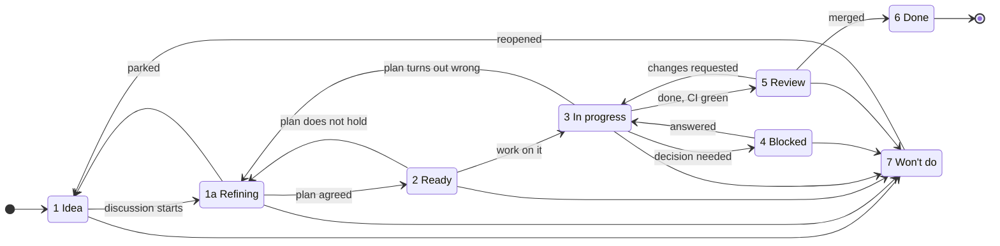
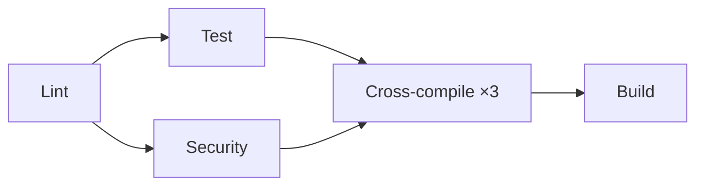

# Contributing

Development is mostly agent-driven, with humans reviewing before merge, so
a few conventions keep the history clean and `main` releasable at all
times. Agents also follow [AGENTS.md](AGENTS.md).

## Workflow

1. **Open an issue first.** Every change starts as an issue, so discussion
   and scope happen before code is written.
2. **Never commit directly to `main`.** The `main` ruleset blocks direct
   pushes; all changes land via pull request.
3. Work in a dedicated worktree branched off the latest `origin/main`; the
   main checkout stays on `main`:
   `git worktree add --no-track /workspaces/worktrees/wg-stream-proxy/<issue-number>-<short-slug> -b <type>/<issue-number>-<short-slug> origin/main`
   After the merge, remove it with `git worktree remove …` and delete the
   local branch; GitHub deletes the remote branch.
4. Push early and open the PR as a **draft** (`gh pr create --draft`);
   GitHub blocks merging drafts. Mark it ready (`gh pr ready`) once the work
   is done and CI is green. End the PR body with `Closes #<issue>`.
5. PRs are merged with **squash merge** (the only allowed method) with the
   **PR title** as the commit subject and an empty commit body; the PR body
   never reaches `main`. Flag a breaking change in the **PR title**
   (`feat(config)!: …`); a `BREAKING CHANGE:` footer in the PR body has no
   effect.

## Labels

Three independent dimensions:

| Dimension | Labels | Rules |
| --- | --- | --- |
| Kind | `idea`, `bug` | optional, set at creation; stays for the issue's life |
| Type | `feat`, `fix`, `perf`, `docs`, `style`, `refactor`, `test`, `build`, `ci`, `chore`, `breaking` | exactly one once the plan is agreed, matching the PR title (`breaking` comes on top); `test` for verification issues without a PR |
| Status | `status/refining`, `status/ready`, `status/in-progress`, `status/blocked`, `status/review`, `status/wont-do` | at most one per issue, see [Issue lifecycle](#issue-lifecycle) |

- `bug` reports broken behavior; the fix then ships as `fix`.
- Apply type labels to PRs too.

## Issue lifecycle

An open issue without a `status/*` label is a new idea; a closed one
without it is done.

| # | State | Status label | Assignee | Meaning |
| --- | --- | --- | --- | --- |
| 1 | Idea | — | — | Just created, nothing refined |
| 1a | Refining | `status/refining` | — | Being discussed; notes and open questions as comments |
| 2 | Ready | `status/ready` | — | Plan agreed and in the issue body; waits for "work on it" or an external trigger |
| 3 | In progress | `status/in-progress` | owner | An agent works on it; draft PR, progress as comments |
| 4 | Blocked | `status/blocked` | owner | Waits for the owner's decision; question in the latest comment |
| 5 | Review | `status/review` | owner | Done, CI green, PR ready; waits for review and merge |
| 6 | Done | — | owner | Merged; worktree and branch removed |
| 7 | Won't do | `status/wont-do` | — | Decided against; reason in a comment |



- Every transition swaps the status label and gets a comment
  (`**Status: <state>** (<from> → <to>)`).
- Large work becomes a parent issue with one sub-issue per PR.

## No AI attribution

Development is AI-assisted, but commit messages and PR descriptions
contain **no AI co-authoring attribution at all**.

## Commit conventions

Commits and PR titles follow
[Conventional Commits v1.0.0](https://www.conventionalcommits.org/en/v1.0.0/).
Use the area as scope (`fix(hls): …`, `feat(config): …`). The type drives
the next version:

| Commit | Version bump | Changelog section |
| --- | --- | --- |
| `feat:` | minor | Features |
| `fix:` | patch | Bug Fixes |
| `perf:` | patch | Performance Improvements |
| `revert:` | patch | Reverts |
| `refactor:` | patch | Code Refactoring |
| `docs:` | patch | Documentation |
| `style:` | patch | Styles |
| `test:` | patch | Tests |
| `build:` | patch | Build System |
| `ci:` | patch | Continuous Integration |
| `chore:` | patch | Chores |
| `!` suffix in the PR title | major (minor while `0.x`) | under its type |

The mapping lives in [`release-please-config.json`](release-please-config.json).

## Dependencies

[Dependabot](https://docs.github.com/en/code-security/dependabot) updates
dependencies weekly ([`.github/dependabot.yml`](.github/dependabot.yml)):

| Ecosystem | Commit prefix | Changelog section |
| --- | --- | --- |
| `github-actions` | `chore(deps)` | Chores, CI only |
| `gomod` | `fix(deps)` | Bug Fixes, changes the binary |

- Minor and patch updates are auto-merged (squash) once the required
  checks pass
  ([`dependabot-automerge.yml`](.github/workflows/dependabot-automerge.yml)).
  Major updates stay open for review.
- gVisor is excluded from automatic updates; it moves together with
  `wireguard-go` ([spec 9](docs/spec.md#9-engineering-rules)).

## Releases

Releases are automated with
[release-please](https://github.com/googleapis/release-please-action)
([`.github/workflows/release-please.yml`](.github/workflows/release-please.yml)):

- pushes to `main` maintain a release PR (`chore(main): release X.Y.Z`)
  with the bumped `.release-please-manifest.json` and the updated
  `CHANGELOG.md`
- the first release is `0.1.0` (`initial-version`)
- merging that PR (squash, title unchanged) tags `vX.Y.Z` and publishes
  the GitHub release
- the workflows authenticate as the GitHub App `KingOfKalk-Release-Bot`,
  so release PRs and auto-merges trigger the other workflows;
  `GITHUB_TOKEN` events don't

Do not tag, bump versions, or edit `CHANGELOG.md` by hand.

## Checks

CI ([`.github/workflows/ci.yml`](.github/workflows/ci.yml)) runs on every
pull request and push to `main`. `Lint`, `Test`, `Security` and `Build`
are the required checks of the `main` ruleset. Each stage starts only when
the previous one passed:



| Check | What | Summary on the run page |
| --- | --- | --- |
| `Lint` | golangci-lint with [`.golangci.yml`](.golangci.yml): `standard` linters (incl. `errcheck`, `staticcheck`) and `gofumpt` | "No issues" or the findings |
| `Test` | `go test -race -cover ./...`, with `goleak` in every package's `TestMain` | passed/failed/skipped, coverage and time per package, failed tests ([`test-summary.jq`](.github/scripts/test-summary.jq)) |
| `Security` | security checks of code and dependencies: govulncheck | "No vulnerabilities found" or the report |
| `Cross-compile (<os>/<arch>)` | `linux/amd64`, `linux/arm64`, `darwin/arm64`, `CGO_ENABLED=0`, version from `git describe` via `-ldflags "-X main.version=…"`; binary uploaded as workflow artifact `wg-stream-proxy-<os>-<arch>` | artifact, version, size, SHA-256 |
| `Build` | passes when all `Cross-compile` jobs pass; fails if an earlier stage failed | overall result |

Run them locally in throwaway containers (no Go toolchain needed, see
[AGENTS.md](AGENTS.md) rule 12), with the versions from `go.mod` and
`ci.yml`:

```sh
run() {
  docker run --rm -v "$PWD":"$PWD" -w "$PWD" \
    --user "$(id -u):$(id -g)" -e HOME=/tmp "$@"
}
run golang:1.27.4 go vet ./...
run golang:1.27.4 go test -race ./...
run golang:1.27.4 go run golang.org/x/vuln/cmd/govulncheck@v1.9.0 ./...
run golangci/golangci-lint:v2.15.0 golangci-lint run ./...
run -e CGO_ENABLED=0 -e GOOS=darwin -e GOARCH=arm64 golang:1.27.4 \
  go build -o /dev/null ./cmd/wg-stream-proxy
```

Dependabot doesn't track the golangci-lint and govulncheck versions in
`ci.yml`; bump them by hand together with this section.
