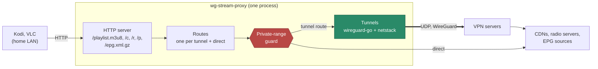
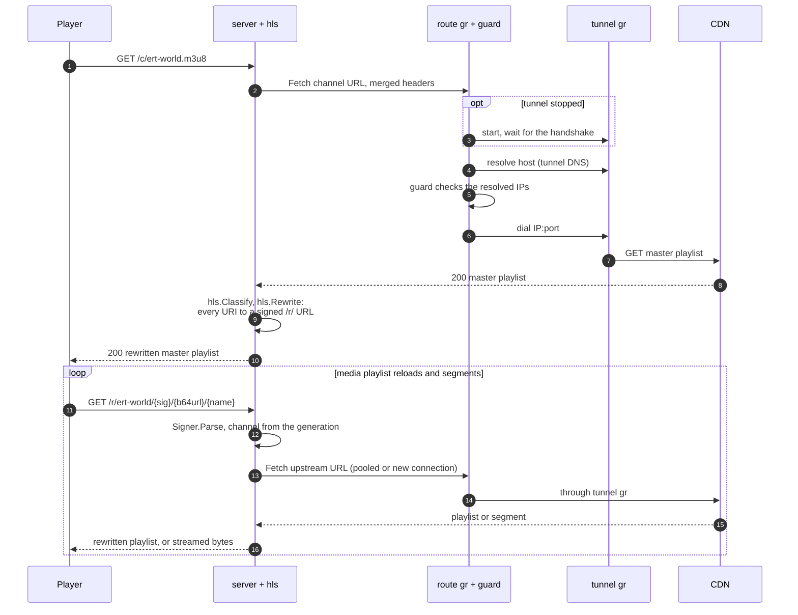
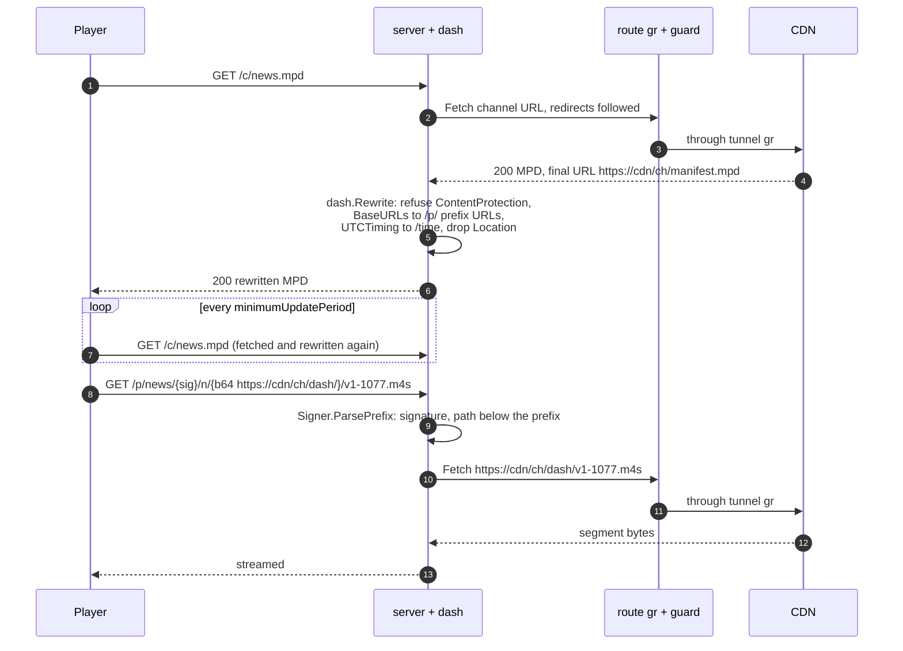
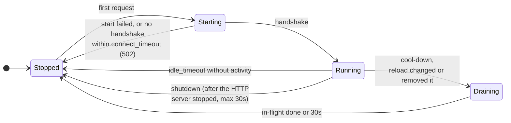
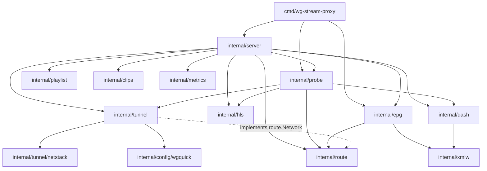

# wg-stream-proxy - Architecture

How wg-stream-proxy works and where each part lives in the code. This
document explains [spec.md](spec.md) and defines nothing; if the two
disagree, the spec wins. "Spec 3.2" refers to a spec section. Type and
function names are those on `main`.

Related: [deploy.md](deploy.md), [observability.md](observability.md),
[testing.md](testing.md)

## 1. System context

- Some streams only play from certain countries. A system-wide VPN moves
  all traffic of the host and serves one country at a time; the proxy
  picks the exit **per channel**: a named WireGuard tunnel or an explicit
  `direct`.
- Players only talk to the proxy. Every playlist, segment, key and
  manifest URL they receive points back to it, so every fetch takes the
  channel's route.
- **Routes**: one per tunnel file plus `direct`, each with its own HTTP
  transports and connection pools. A channel's route is fixed when the
  config loads (spec 5.2); a request never falls back to another route.
- **Guard**: sits between name resolution and connect of every upstream
  dial on every route, redirect hops included, so it checks the exact IP
  that is dialed (spec 3.5).
- **Tunnels**: one wireguard-go device with a gVisor netstack per tunnel
  file, in userspace, shared by all channels on it (one key, one UDP
  session). Upstream host names are resolved inside the tunnel.
- **EPG**: in link mode the channel list links `epg.url` and the player
  fetches it itself. In proxy mode `epg.Guide` fetches each
  `[[epg.source]]` through its route, filters it to the configured
  channels, merges the copies and serves the guide from memory (spec 6.1).

## 2. Request flows

### 2.1 HLS channel

Channel `ert-world` on tunnel `gr` (spec 5.4).

- `/playlist.m3u8` is rendered from the active config (`playlist.Render`)
  without an upstream request; it links each channel as `/c/{id}`
  (with `.m3u8` or `.mpd` by type, spec 6), unsigned and stable.
- Steps 2-7: the first request on a stopped tunnel starts it
  (section 3). The guard runs on every new connection; a pooled connection
  was checked when it was dialed.
- Step 9: `hls.Classify` picks HLS, DASH, raw or refused (spec 3.1, shared with `probe`). For HLS,
  `hls.Rewrite` with a `Signer.PathBuilder` replaces every `http(s)` and
  relative URI with `/r/{channel}/{sig}/{b64url}/{name}`. A playlist it
  cannot rewrite safely fails with `502` (spec 3.2). The rewrite is
  stateless: the player picks variants and renditions.
- `/r/`: the signature binds the upstream URL to the channel; route and
  headers always come from the channel config, never from the URL.
  Sub-playlists are rewritten again, playlist formats the proxy does not
  rewrite (`hls.Classify`) are refused with `502` (spec 3.3), and
  everything else (segments, keys) is streamed with `io.Copy` and flush.
- Activity: a request counts for its tunnel (`route.Activity`) from before
  its first lookup until its body is closed, so an open stream keeps the
  tunnel up and an idle pooled connection does not.
- Failures map to `502` or `504` (spec 3.4). A `GET` of `/c/` of a channel
  listed with `.m3u8` gets an error clip instead: a VOD playlist with one
  embedded segment from `internal/clips` under `/clip/{name}.ts`.
- Raw and ICY streams (radio, MPEG-TS) take the same path without a
  rewrite: anything not detected as HLS or DASH is piped. `/c/` of `raw`
  and `auto` channels uses the route's second transport, whose connection
  wrapper turns a Shoutcast `ICY 200 OK` status line into `HTTP/1.0 200 OK`
  (spec 3.3).

### 2.2 DASH channel

A live channel whose URL redirects to a CDN; the manifest has a relative
Period `BaseURL` `dash/` and a `SegmentTemplate` with `$Time$`.

- The player builds segment URLs from templates, so one signature covers
  a directory: `Signer.PrefixPath` signs the upstream prefix for the
  channel, and `/p/` accepts any path below it that cannot step out
  (spec 4.1). Plain relative templates stay as they are and resolve
  against the rewritten `BaseURL`.
- `dash.Rewrite` parses the manifest token by token and writes it again,
  so players with lighter XML parsers read the same URLs (spec 3.6, 8).
- Like HLS, the rewrite is stateless, and route and headers come from the
  channel config at request time.

## 3. Tunnel lifecycle

- `*tunnel.Tunnel` implements `route.Network` (`LookupNetIP`,
  `DialContext`) and `route.Activity`; `route.Host()` is the `direct`
  network with the host resolver and dialer. `tunnel.Manager` holds one
  `Tunnel` per tunnel file.
- Lazy start (`ensure`): concurrent callers share one `startCall`;
  `startDevice` resolves the `Endpoint` with the host resolver, builds the
  UAPI text (`wgquick.Tunnel.UAPIConfig`), creates netstack and device and
  waits for the first handshake, all within `connect_timeout`. A failure
  is `tunnel.ErrUnavailable` (`502`, or the `tunnel-unreachable` clip).
- Dial check: an address outside the peer's `AllowedIPs` or of an address
  family the tunnel lacks fails with `tunnel.ErrNotAllowed` before anything
  is sent (spec 5.5).
- DNS: `dnsClient` resolves over UDP and TCP inside the netstack, with the
  retries and the per-tunnel cache of spec 2.1.
- Device and netstack (`running`) exist only while the tunnel runs. Every
  stop ends in `running.close`: the idle timer, a reload that retires the
  tunnel (`Update.Commit` after `Manager.Apply` cancels a start in
  progress and drains running requests), a cool-down (`Manager.Cooldown`)
  and shutdown. The `OnStop` hook makes the route close its idle pooled
  connections; the DNS cache is dropped.
- `internal/tunnel/netstack` is a trimmed copy of wireguard-go's
  `tun/netstack` that drops packets sent after `Close` (spec 9).
- Keys stay inside: the UAPI text is never logged, wireguard-go's own log
  lines name the peer by tunnel name, and every logged upstream URL goes
  through `route.LogURL` (spec 8).

## 4. Package map

Main dependencies only: `internal/config` is imported by most packages
and left out, as are the other direct imports of `cmd/wg-stream-proxy`.

| Package | Role |
|---|---|
| `cmd/wg-stream-proxy` | Commands and flags (spec 7.2); `SIGHUP` and signal handling |
| `internal/config` | Config dir (`Resolve`), loading and validation (`Load`), merge layers, slugs (`Slug`), route resolution |
| `internal/config/wgquick` | Tunnel file parser, UAPI conversion, `AllowedIPs` check |
| `internal/server` | HTTP handlers, the generation and its reload (`Reloader`, `Watch`), `Server.proxy` (fetch, detect, rewrite or stream, status mapping, error clips), `/logos/`, `/time`, EPG guide serving, debug listener, graceful shutdown (`Run`) |
| `internal/playlist` | Channel list (`Render`, spec 6) |
| `internal/hls` | Detection (`Classify`, shared by serving and `probe`), HLS rewrite, `/r/` and `/p/` signing (`Signer`), signing key; pure functions |
| `internal/dash` | DASH manifest rewrite (spec 3.6); pure function |
| `internal/xmlw` | Writes XML again from `encoding/xml` tokens for `dash` and `epg`: tags, escaping, the plain-name check; the caller decides what is kept; pure functions |
| `internal/route` | One `Route` per tunnel plus `direct`: transports, guard, header rules, redirects, timeouts, `Trace` of the phases; defines `Network` and `Activity` |
| `internal/tunnel` | `Manager` and `Tunnel`: lazy start, idle close, drain, reload (`Apply`), cool-down, tunnel DNS |
| `internal/tunnel/netstack` | Patched copy of wireguard-go's `tun/netstack` (spec 9) |
| `internal/epg` | `epg ids`, the XMLTV filter (`Filter`), merge (`Merge`) and refresh with last good copies (`Guide`) |
| `internal/probe` | The `probe` checks, run by `POST /debug/probe` of the server |
| `internal/clips` | The embedded error clip segments, rendered by `generate.sh` |
| `internal/metrics` | Private Prometheus registry with the `wsp_` metrics (spec 7.3) |

### 4.1 Reload and generations

- A **generation** is one loaded `config.Config` plus the `route.Set`
  built for it, held in an `atomic.Pointer`. A request takes the current
  generation once and keeps it to its end. The users of its routes
  (`/c/`, `/r/`, `/p/` requests, EPG fetches, the debug probe) are
  counted; the last user of a replaced generation closes the idle
  connections it left in the old pools, and nothing else keeps it.
  `Server.use` also counts each user on its route's tunnel
  (`route.Route.Begin`) until it ends, and returns a generation only if
  it is still active after that count; EPG fetches count as background
  requests (`route.Route.BeginBackground`), which keep the tunnel up but
  are not activity for its idle close (spec 2.1).
- `SIGHUP` and the changes `server.Watch` sees call `Reloader.Reload`. It
  loads all files (`config.Load`, `tunnel.Parse`); if they are valid,
  `Manager.Apply` adds the new tunnel set, `route.NewSet` builds new
  routes (empty pools; the old routes close their idle connections), the
  new generation serves new requests, and only then `Update.Commit`
  retires the replaced tunnels: their drain sees every request of the old
  generation. An error in between rolls the tunnel set back
  (`Update.Rollback`). An invalid config changes nothing (spec 5.6).
  `cmd/wg-stream-proxy` wires the signal and the watcher to the reloader.

### 4.2 Observability

- `Server.proxy` counts each `/c/`, `/r/` and `/p/` request in
  `metrics.Metrics` and records the `route.Trace` of its upstream
  requests; when the request ends, `Server.requestFinished` feeds the
  timing histograms and the debug `request` line.
- The tunnel manager reports each successful start
  (`wsp_tunnel_start_seconds`); the tunnel gauges are read at scrape time,
  so nothing polls the devices.
- The debug endpoints (profiles, tunnel state, cool-down, probe) run on
  their own listener, never on the main one (spec 7.1).

## 5. Glossary

| Term | Meaning |
|---|---|
| Channel | One entry of the channel list: name, upstream URL, route, playlist attributes (`channels.d/*.toml`) |
| Upstream | The server a stream really comes from, and its URL |
| Route | How a channel reaches its upstream: a named tunnel or `direct`, each with its own HTTP client |
| Tunnel | A userspace WireGuard connection built from one `tunnels/*.conf` file, shared by all channels on it |
| `direct` | The reserved route over the host network; used only where the config says so |
| Guard | The private-range guard: checks every dialed IP and blocks LAN, loopback and similar ranges unless allowed per route |
| Fail closed | When something is wrong, the request fails; it never takes a less safe path |
| Resource URL | A signed `/r/` URL that replaces an upstream URL in a rewritten playlist |
| Prefix URL | A prefix-signed `/p/` URL that replaces a base URL in a rewritten DASH manifest and covers every path below it |
| Signing key | The HMAC key of resource and prefix URLs |
| Generation | One loaded config with its routes; a request keeps the one it started with |
| Error clip | A short built-in video that `/c/` of an HLS channel serves instead of an HTTP error |
