# wg-stream-proxy - Architecture

How wg-stream-proxy works, in diagrams first and short text second. This
document explains [spec.md](spec.md); it defines nothing new. If the two
ever disagree, the spec wins. Section numbers like "spec 3.2" refer to it.

Related: [spec.md](spec.md), [deploy.md](deploy.md), [testing.md](testing.md)

## Contents

1. [The problem](#1-the-problem)
2. [System context](#2-system-context)
3. [Control plane and data plane](#3-control-plane-and-data-plane)
4. [Request flows](#4-request-flows)
5. [Routing and the guard](#5-routing-and-the-guard)
6. [Tunnel lifecycle](#6-tunnel-lifecycle)
7. [Internals](#7-internals)
8. [Package map](#8-package-map)
9. [Versions](#9-versions)
10. [Deployment](#10-deployment)
11. [Glossary](#11-glossary)

Colours used in all diagrams:

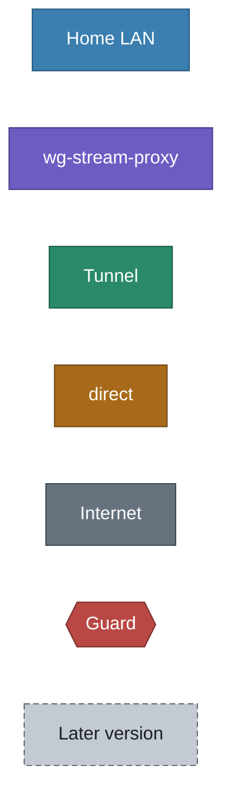

## 1. The problem

- Some TV and radio streams only play from a certain country. A VPN
  solves that, but a system-wide VPN moves *all* traffic of the host, and
  a household often needs several countries at once.
- wg-stream-proxy picks the exit **per channel**: each channel goes through
  its own WireGuard tunnel (for example `gr` for Greek TV), or explicitly
  `direct` over the normal internet connection.
- The tunnels run **in userspace inside the proxy process**: no TUN
  device, no root, no kernel module. Nothing else on the host is affected.
- Players (Kodi IPTV Simple Client, VLC) only see **one M3U8 channel
  list** on the LAN. Every stream, playlist, segment and key is fetched
  through the proxy, so it always takes the channel's route.
- **Fail closed**: a channel never silently bypasses its tunnel. A broken
  tunnel means an error, never a direct connection.
- Scale: a household, 3 concurrent viewers (spec 1.1).

## 2. System context

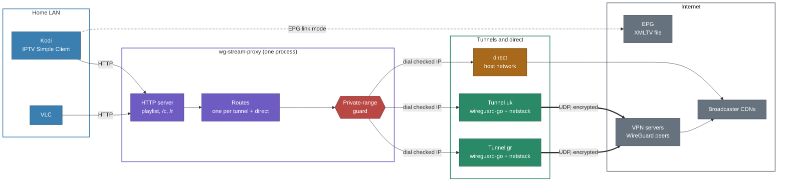

- **Players** talk plain HTTP to the proxy on the LAN (default port
  `2349`). They never contact a broadcaster themselves.
- **Routes**: one per tunnel file plus `direct`. Each has its own HTTP
  client with connection pooling (spec 2.1). A channel's route comes from
  its config (section 5).
- **Guard**: sits in front of *every* upstream dial on every route. It
  checks the resolved IP, so redirects and DNS tricks cannot reach the LAN
  or the host (spec 3.5).
- **Tunnels**: one `wireguard-go` device with a gVisor netstack per tunnel
  file, shared by all channels and viewers on it: one key, one UDP
  session. Host names are resolved inside the tunnel with the tunnel's
  `DNS` servers.
- **direct**: the host network, same HTTP settings, same guard. Used only
  where a channel says `tunnel = "direct"`.
- **EPG**: in v0.1 the channel list only *links* the EPG URL
  (`x-tvg-url`); the player downloads it itself (spec 6). Only the CLI
  (`epg ids`, `epg match`, `import --match-epg`) downloads it, over `direct`
  (spec 7.2).

## 3. Control plane and data plane

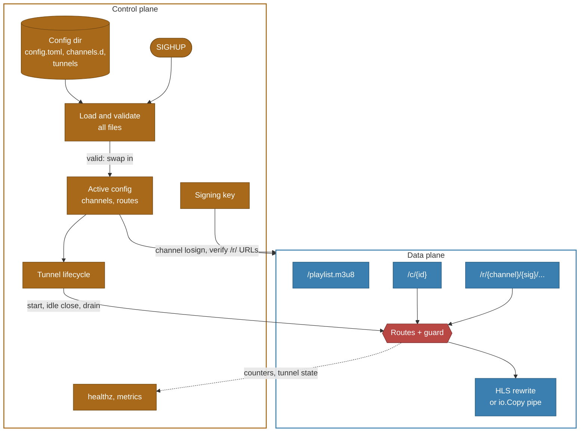

**Control plane**: decides *what* exists and *how* traffic may flow.

- Config dir (spec 5.1): `config.toml`, `channels.d/*.toml` (with the
  global defaults `channels.d/_defaults.toml`), tunnel files
  in `tunnels/*.conf` (`wg-quick` format, converted to a WireGuard UAPI
  config internally).
- Load and validate: everything is checked at once; all errors are
  reported with file and line. At startup an invalid config exits with
  code `1` (`wg-stream-proxy check` runs only this step).
- `SIGHUP` reload (spec 5.6): the new config is validated completely. An
  invalid one is rejected and the old one keeps serving. Unchanged tunnels
  keep running; changed or removed tunnels are drained.
- Tunnel lifecycle: lazy start, idle close, drain (section 6).
- Signing key: signs and verifies `/r/` URLs (spec 4). Changing it needs
  a restart, like `listen` and the tunnels dir location.
- `/healthz` and `/metrics` (Prometheus, `wsp_` prefix, spec 7.3).

**Data plane**: moves bytes for players.

- `/playlist.m3u8`: renders the channel list from the active config. No
  upstream request, no tunnel.
- `/c/{id}`: the stable, unsigned entry point of a channel. Fetches the
  channel URL through the channel's route, then rewrites (HLS) or pipes
  (raw).
- `/r/...`: signed resources found inside rewritten playlists:
  sub-playlists, segments, keys. Same route and headers as the channel.
- Responses: playlists are rewritten, everything else (segments, keys,
  raw streams) is piped with `io.Copy`.
- The planes touch in four places: each request reads the *active*
  config, `/c/` and `/r/` use the signing key, each upstream dial goes
  through a route whose tunnel the lifecycle manager runs, and each
  request updates the metrics.

## 4. Request flows

### 4.1 Player loads the channel list

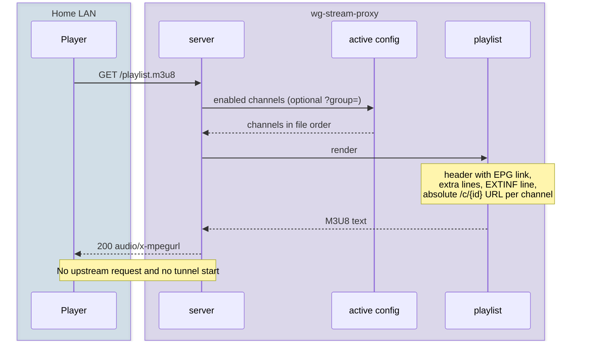

- Each entry points to `/c/{id}.m3u8` if `upstream.type = "hls"` or the
  upstream URL path contains `.m3u8`, otherwise to `/c/{id}` (spec 6). URLs are absolute: `public_base_url`, else
  `X-Forwarded-*`, else the request `Host` (spec 7.1).
- `#KODIPROP` and other `extra` lines appear only here, never in
  playlists under `/c/` or `/r/`.

### 4.2 HLS channel

Example channel from spec 5.4: `ert-world` on tunnel `gr`.

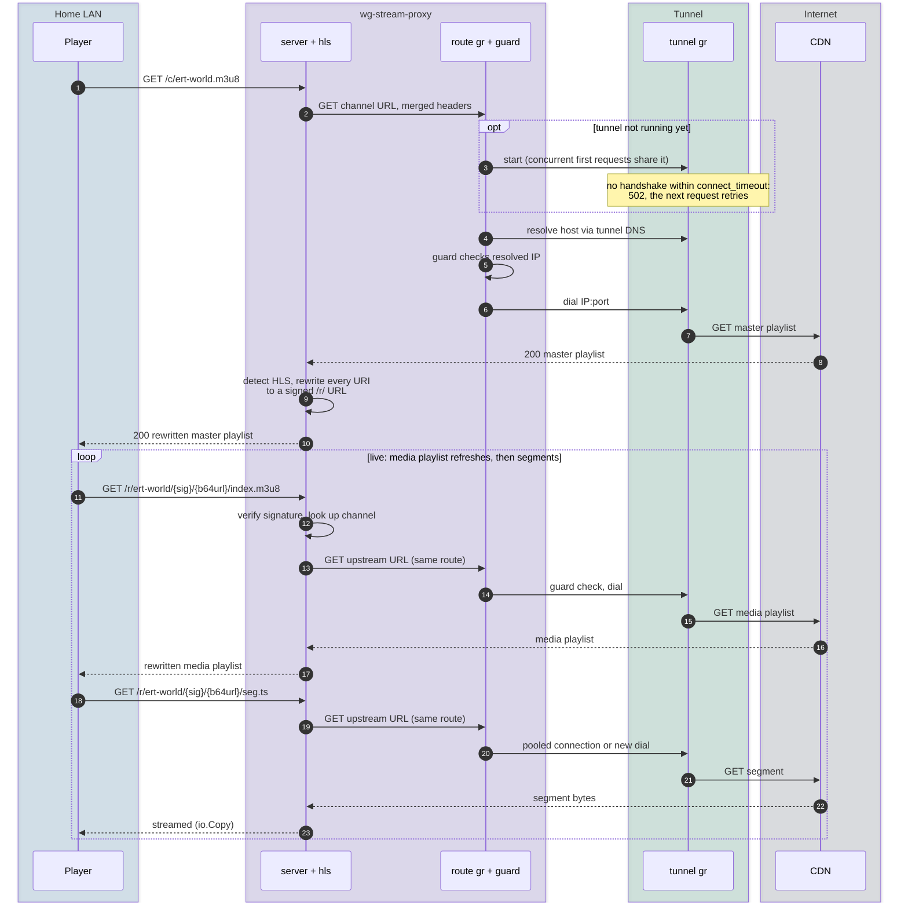

- Steps 2-8: `/c/` fetches the channel URL through the channel's route.
  The first request on a stopped tunnel starts it (section 6).
- Step 9: type detection (spec 3.1, `hls.Detect`): configured
  `upstream.type`, else `Content-Type`, else `#EXTM3U` at the start of the
  body, otherwise raw. Here: HLS, so `hls.Rewrite` replaces every
  `http(s)` and relative URI with `/r/{channel}/{sig}/{b64url}/{name}`
  (`hls.PathBuilder`, one HMAC state per playlist).
  Anything it cannot rewrite safely makes the whole playlist fail with
  `502` (fail closed, spec 3.2).
- The rewrite is **stateless**: the player chooses variants and
  renditions; the proxy keeps no session.
- `/r/` (spec 4): the signature binds the URL to the channel. A tampered
  URL, an unknown or a disabled channel gives `404`. Route and headers
  always come from the channel config, never from the URL.
- Sub-playlists are detected and rewritten again; everything else
  (segments, keys, init segments) is streamed unchanged. AES-128 keys are
  passed through; the player decrypts.
- Status mapping (spec 3.4): upstream `2xx`/`4xx` pass through, `5xx` and
  connection errors give `502`, timeouts `504`.

### 4.3 Radio: raw and ICY stream

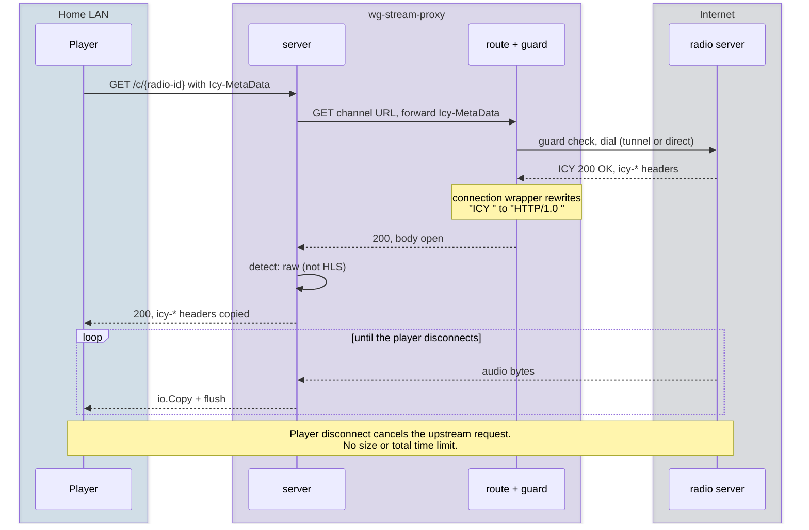

- Raw passthrough (spec 3.3) covers radio and MPEG-TS: anything that is
  not detected as HLS.
- Shoutcast v1 servers answer `ICY 200 OK` instead of an HTTP status
  line; the route's connection wrapper fixes that before Go's HTTP parser
  reads it.
- An open stream counts as tunnel activity, so the tunnel stays up while
  someone listens.

## 5. Routing and the guard

### 5.1 Which route a channel takes

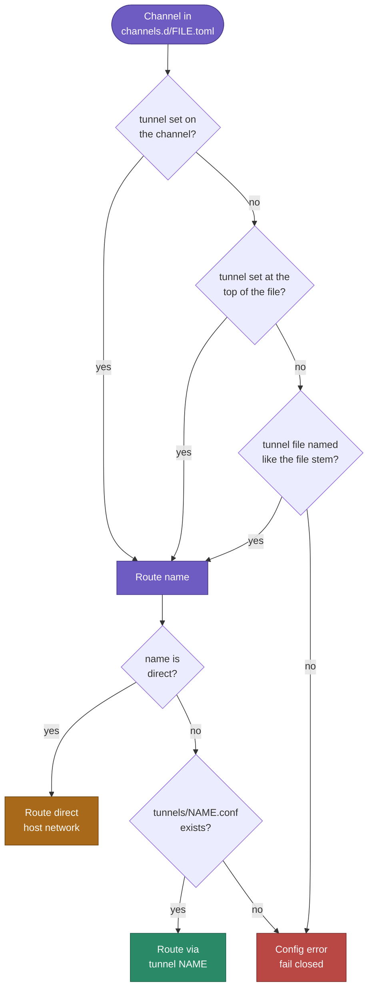

- First match wins (spec 5.2). The route is fixed when the config is
  loaded, not per request.
- `channels.d/_defaults.toml` sets no route: a global `tunnel` is a
  config error (spec 5.4).
- `direct` is never a default: it is used only where it is written. A
  channel without a route is a config error, so it can never fall back to
  the host network.
- `direct` is a reserved name; no tunnel file can be called `direct.conf`.

### 5.2 The private-range guard

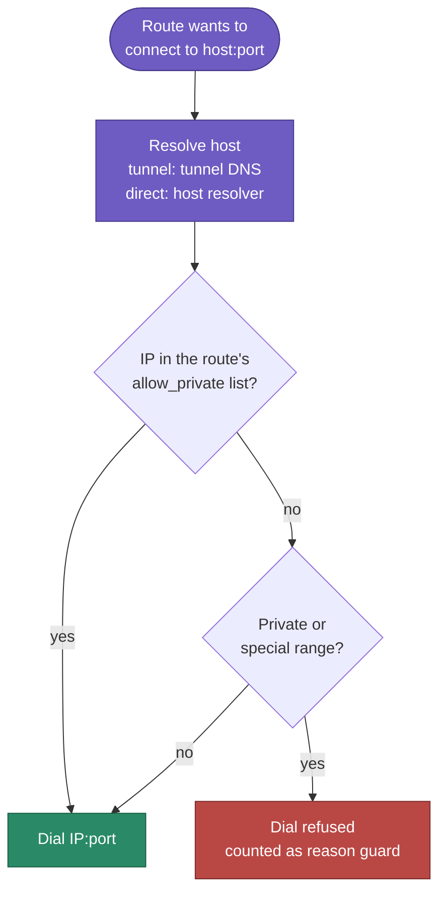

- Every route offers two operations to the HTTP client: resolve a host
  name, and dial an already resolved `IP:port`. Tunnels resolve and dial
  through their netstack, `direct` through the host. The guard sits
  between the two, so it checks the exact IP that will be dialed.
- It runs on **every** dial: the channel URL, every `/r/` resource and
  every redirect hop (max 10). DNS rebinding to a private IP is caught
  too.
- Blocked ranges: loopback, RFC 1918, RFC 6598, link-local, IPv6 ULA,
  unspecified, multicast, and the IPv4-mapped forms of these.
- Public IPs and any port are allowed. Exceptions are per route, for
  example `[upstream.allow_private] direct = ["192.168.1.0/24"]`.
- Not guarded (spec 3.5): the WireGuard `Endpoint` (UDP from the host)
  and the tunnel's `DNS` servers.
- Inside a tunnel, `AllowedIPs` narrower than `0.0.0.0/0, ::/0` also
  limits which upstream IPs are reachable; others fail (spec 5.5).

## 6. Tunnel lifecycle

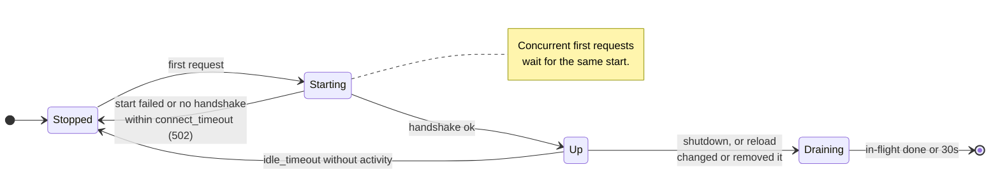

- **Lazy start** (spec 2.1): nothing connects at startup. The first
  request for a channel on a stopped tunnel starts it. The `Endpoint` host
  name is resolved by the host resolver at that moment.
- **Start failure**: if the device cannot start or no handshake happens
  within `connect_timeout`, the waiting requests get `502`. The tunnel
  returns to *Stopped*; the next request tries again.
- **Idle close**: after `[tunnels] idle_timeout` (default `60m`) without
  activity the tunnel closes. Activity = any in-flight request or open
  stream.
- **Drain**: on shutdown or when a reload changes or removes a tunnel,
  in-flight requests get up to 30s, then the tunnel closes. A changed
  tunnel is recreated lazily: the new one starts in *Stopped*. Such a
  reload cancels a start in progress; its requests get `502` (spec 5.6).
- `wsp_tunnel_up{tunnel}` is `1` while the device runs and the last
  handshake is younger than 180s (spec 7.3).

## 7. Internals

How one running `wg-stream-proxy serve` process is built inside. The
sections above show what happens; this one shows which part of the code
does it. Type and function names are those on `main`; the code is
authoritative for them, the spec for the behaviour.

### 7.1 Layers and planes

Colours in this diagram mark the **planes**, as in section 3: blue is the
data plane (thick arrows), amber the control plane, purple the
observability plane (dotted lines). Red is the guard, grey the host
network. Section 3 counts health and metrics to the control plane; here
they are a plane of their own.

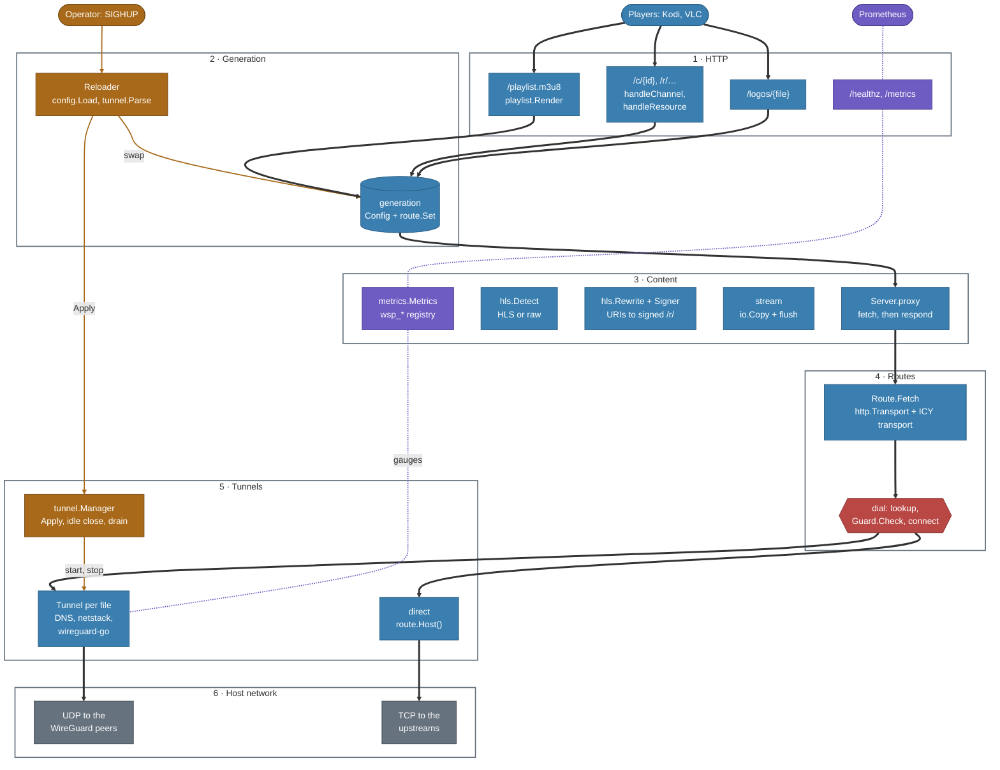

Requests go down the layers, responses travel back up.

| Layer | Owns | Package | Spec |
|---|---|---|---|
| 1 HTTP | Routing of the paths, absolute base URL, `/logos/` from disk, `/healthz`; graceful shutdown waits for running handlers | `internal/server`, `internal/playlist` | 6, 7.1 |
| 2 Generation | The immutable `generation`: one `config.Config` plus the `route.Set` built for it, in an `atomic.Pointer`. Every request takes it once and keeps it to its end | `internal/server`, `internal/config` | 5.6 |
| 3 Content | `Server.proxy`: fetch through the channel's route, then `hls.Detect`; playlists go through `hls.Rewrite` with a `Signer.PathBuilder`, everything else through `stream` (`io.Copy` + flush). Status mapping, the `206` refetch | `internal/hls`, `internal/server` | 3.1-3.4, 4 |
| 4 Routes | One `Route` per tunnel plus `direct`. `Fetch` applies the upstream header rules, redirects and timeouts; the route's `dial` resolves, runs `Guard.Check` and connects Happy-Eyeballs style. Two `http.Transport`s per route: the normal pool, and the ICY transport for `/c/` of raw and `auto` channels, which uses each connection for one request only | `internal/route` | 2.1, 3.3-3.5 |
| 5 Tunnels | `tunnel.Manager` with one `Tunnel` per tunnel file: lazy start, idle close, drain, reload (`Apply`). `direct` is `route.Host()`: host resolver and dialer | `internal/tunnel`, `internal/tunnel/netstack`, `internal/config/wgquick` | 2.1, 5.5 |
| 6 Host network | One UDP socket per running tunnel to its peer; plain TCP for `direct`. No TUN device, no routing table change | wireguard-go `conn` | 1.1, 2.1 |

- **Data plane**: a player request goes down the layers and back. The
  route layer only knows the `route.Network` interface (resolve a host,
  dial an `ip:port`); `*tunnel.Tunnel` and `route.Host()` implement it.
- **Control plane**: `cmd/wg-stream-proxy` turns `SIGHUP` into
  `Reloader.Reload`. It loads all files (`config.Load`, `tunnel.Parse`);
  if they are valid, `Manager.Apply` swaps the tunnel set,
  `route.Set.Next` builds the next routes (unchanged routes keep their
  pools), and the new generation is swapped in for new requests. Running
  requests finish on the old one. An invalid config changes nothing.
- **Observability plane**: `metrics.Metrics` is a private Prometheus
  registry. `Server.proxy` writes the request counters; the tunnel gauges
  are read from the tunnels at scrape time, so nothing polls the devices.
  `/healthz` only says that the process serves.

### 7.2 Channels, routes and tunnels

Example: two channels in `channels.d/gr.toml` take tunnel `gr` from the
file name, a radio channel names `uk`, and one channel is `direct`.

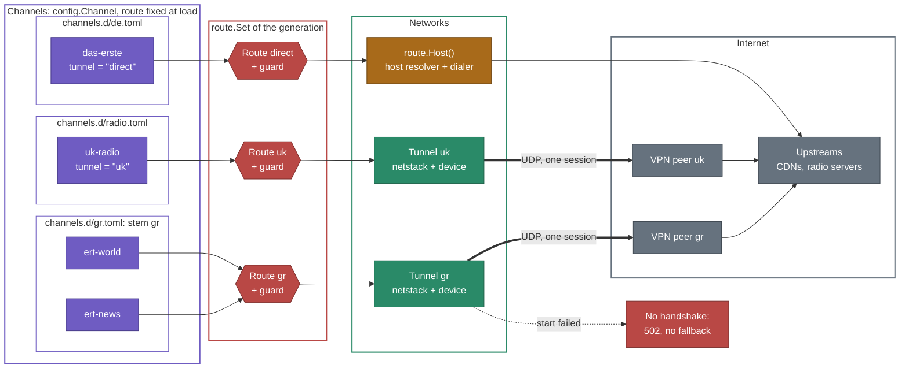

- The route of a channel is fixed when the config loads (section 5.1,
  spec 5.2); the handler looks it up by name in the generation's
  `route.Set`.
- **Routes are shared** by all channels that name them: one guard with
  the route's `allow_private` list, one connection pool per transport.
- **Tunnels are shared** by all routes and viewers: one `Tunnel` per
  tunnel file, one key, one UDP session to the peer (spec 2.1). Only the
  route of the same name uses it.
- **`direct` bypasses tunnels** but not the guard: same transport
  settings, host resolver and dialer. It has no idle close and no drain.
- **Nothing falls back**: a route only knows its own network. If a tunnel
  cannot start or the guard blocks every address, the request fails with
  `502`; it never takes another route.

### 7.3 Inside one tunnel

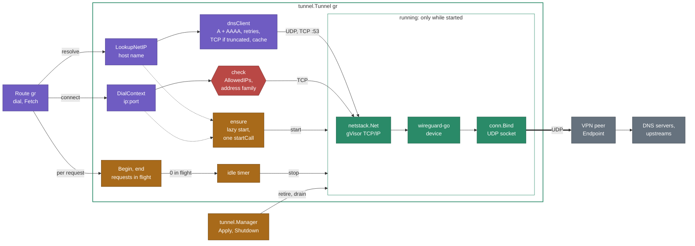

- **Interface to the route layer**: `*tunnel.Tunnel` implements
  `route.Network` (`LookupNetIP`, `DialContext`) and `route.Activity`
  (`Begin`, returning `end`). The route counts each request from before
  its first lookup until its body is closed.
- **`check`**: an address must be inside the peer's `AllowedIPs` and of a
  family the tunnel has an `Address` for, else `ErrNotAllowed` before
  anything is sent (spec 5.5). Lookup answers and the file's `DNS`
  servers are filtered the same way.
- **`dnsClient`**: tunnel DNS over UDP and TCP inside the netstack, A and
  AAAA in parallel (only for families the tunnel has), first attempt to
  every `DNS` server at once, retries after 0.5s, 1s, 2s, then every 4s
  on the next server, TCP after a truncated answer, IPv4 answers first
  (spec 2.1). It replaces the netstack resolver, which retries only after
  5s. It lives in `running`: answers are cached by TTL (10s to 5min, 256
  entries) only while the device runs, concurrent lookups of a name share
  one query, and every stop drops the cache.
- **`ensure`**: the lazy start. Concurrent callers wait for one
  `startCall`; `startDevice` resolves the `Endpoint` with the host
  resolver, builds the UAPI text (`wgquick.UAPIConfig`), creates the
  netstack and the device, and waits for the first handshake, all within
  `connect_timeout`. A failure is `ErrUnavailable`, answered with `502`.
- **`running`** (device + netstack) exists only while the tunnel is up.
  Every stop ends in `running.close`: the idle timer (armed when the last
  request ends, `idle_timeout` after the last activity), a reload that
  retires the tunnel (`Apply`: a start in progress is cancelled, requests
  in flight get up to 30s), and `Shutdown`. Before the device closes, the
  `OnStop` hook makes the route close its idle pooled connections.
- **`internal/tunnel/netstack`** is a trimmed copy of wireguard-go's
  `tun/netstack` with one change: a packet gVisor sends after `Close` is
  dropped instead of sent on a closed channel, which crashed the process
  ([#47](https://github.com/KingOfKalk/wg-stream-proxy/issues/47), spec
  9). It is updated together with wireguard-go.
- Keys stay inside: the UAPI text is never logged; wireguard-go's own log
  output reaches the debug log only with the peer shown by tunnel name and
  anything key-like redacted (spec 8).
- Upstream URLs stay out of the logs: every logged URL, and `route.Error.URL`
  (which ends up in error messages), goes through `route.LogURL` and shows
  only scheme, host and file name (spec 8).

### 7.4 A segment request through the layers

A `/r/` segment of `ert-world` while tunnel `gr` is already up.

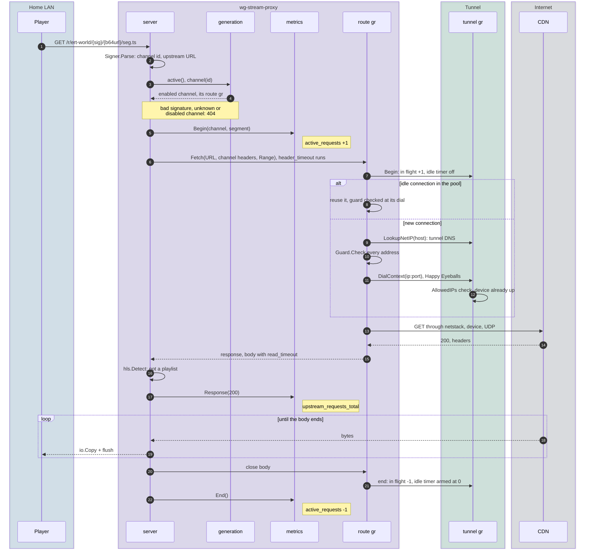

- Steps 2-4 (layers 1-2): the signature binds the URL to the channel; the
  generation taken here serves the request to its end, even if a reload
  swaps in a new one meanwhile.
- Step 5: `wsp_active_requests{channel,kind}` counts from here. The kind
  is `segment` because the path does not end in `.m3u8` or `.m3u`; a
  detected playlist would switch it to `playlist`.
- Step 7: from here until step 21 the request is tunnel activity, so an
  open stream keeps the tunnel up and an idle pooled connection does not.
- Steps 8-12 (layer 4): the guard runs on every new connection, also for
  each redirect hop, never on a reused one (it was checked when it was
  dialed).
- Step 17: `wsp_upstream_requests_total{channel,kind,code}`. On an error
  before the response, `FetchError` counts `code="error"` and
  `wsp_upstream_errors_total{channel,reason}`, and the player gets `502`
  or `504`. A request the player gave up counts no error.
- A playlist (step 16 detects HLS) is read whole, rewritten and sent
  instead of streamed, as in section 4.2.

## 8. Package map

Layout per spec 9. Arrows show the expected main dependencies; package
boundaries inside this layout are an implementation choice, so the code is
authoritative.

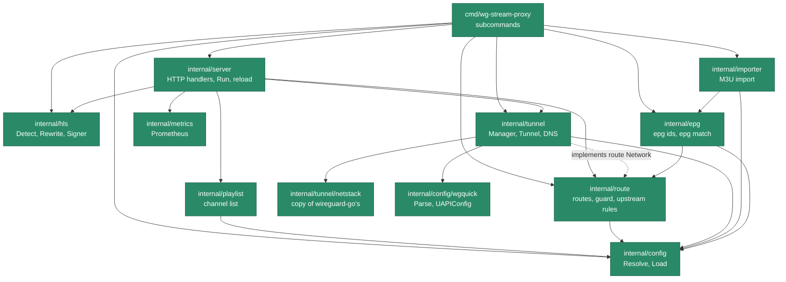

All packages of v0.1 exist on `main`. Section 7 shows how they work
together at run time.

| Package | Role | Status |
|---|---|---|
| `cmd/wg-stream-proxy` | Subcommand dispatch; `serve`, `check`, `import`, `healthcheck`, `epg` and `version` work | exists |
| `internal/config` | Config dir resolution (`Resolve`), loading and validation of `config.toml` and channel files (`Load`), slugs (`Slug`), route resolution | exists |
| `internal/config/wgquick` | Tunnel file parser (`Parse`), UAPI conversion (`UAPIConfig`), `AllowedIPs` check (`Allows`) | exists |
| `internal/hls` | Type detection (`Detect`), playlist rewriter (`Rewrite`), signed `/r/` URLs (`Signer`), signing key (`LoadSigningKey`); pure functions, no I/O | exists |
| `internal/tunnel` | One `wireguard-go` device + gVisor netstack per tunnel, DNS inside the tunnel, lazy start ([#11](https://github.com/KingOfKalk/wg-stream-proxy/issues/11)); idle close and drain ([#16](https://github.com/KingOfKalk/wg-stream-proxy/issues/16)); reload (`Manager.Apply`) | exists |
| `internal/tunnel/netstack` | Trimmed copy of wireguard-go's `tun/netstack` (MIT) that drops packets sent after `Close` ([#47](https://github.com/KingOfKalk/wg-stream-proxy/issues/47), spec 9) | exists |
| `internal/route` | One route per tunnel plus `direct`, `http.Transport` settings, guard, upstream header rules, timeouts, status mapping ([#12](https://github.com/KingOfKalk/wg-stream-proxy/issues/12)); raw and ICY ([#15](https://github.com/KingOfKalk/wg-stream-proxy/issues/15)). Defines the `Network` interface (resolve + dial a resolved `IP:port`) that tunnels and `direct` implement | exists |
| `internal/server` | `/playlist.m3u8`, `/c/`, `/r/`, `/healthz`, absolute URL base, graceful shutdown (`Run`) ([#14](https://github.com/KingOfKalk/wg-stream-proxy/issues/14)); `/logos/`, `healthcheck` ([#19](https://github.com/KingOfKalk/wg-stream-proxy/issues/19)); `/metrics` ([#18](https://github.com/KingOfKalk/wg-stream-proxy/issues/18)); `SIGHUP` reload (`Reloader`) | exists |
| `internal/playlist` | Renders the channel list (spec 6) | exists |
| `internal/metrics` | Private Prometheus registry with the `wsp_` metrics (spec 7.3) and the Go and process metrics; tunnel gauges read at scrape time ([#18](https://github.com/KingOfKalk/wg-stream-proxy/issues/18)) | exists |
| `internal/importer` | `import` of an existing M3U file (spec 7.2), `--match-epg` with an `epg.Index`; pure function, no I/O | exists |
| `internal/epg` | Downloads `epg.url` over the direct route, streams the XMLTV channel list (plain or gzip), ranks EPG names for `epg match` and `import --match-epg` (spec 7.2, [#21](https://github.com/KingOfKalk/wg-stream-proxy/issues/21)) | exists |

## 9. Versions

### 9.1 What each version adds

| Version | Adds | Where it shows up |
|---|---|---|
| **v0.1 Core** | Everything in the spec: config, tunnels, routes and guard, HLS rewrite, raw/ICY, signed `/r/`, channel list, `SIGHUP` reload, metrics, `import`, `epg`; Dockerfile, Compose file, image on `ghcr.io` (`linux/amd64`, `linux/arm64`); test layers L1-L6 | the whole picture above |
| **v0.2 Experience** | Placeholder and error clips with seamless switchover (own design doc), per-request prefetch, file-watch reload | data plane (clips, prefetch), control plane (reload trigger) |
| **v0.3 Distribution** | GoReleaser, systemd unit, launchd plist, Kustomize | deployment only |
| **Later** | 32-bit ARM, scaling beyond 3 viewers, EPG proxy mode, logo proxying, per-tunnel overrides, ad-hoc proxy endpoint, DASH | mostly data plane |

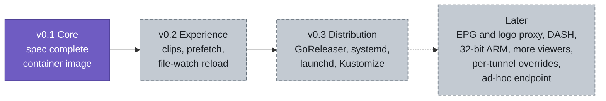

### 9.2 Final version

The same structure as in section 2; future parts are grey and dashed. The
details of v0.2 and later are not specified yet (the clips get their own
design doc), so this shows only *where* each part fits.

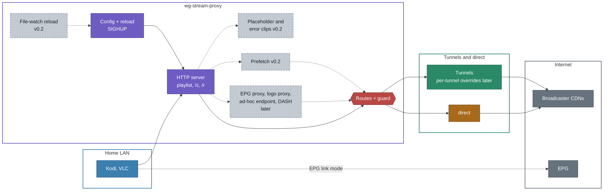

- The core stays the same in every version: one process, routes with the
  guard in front of every dial, tunnels in userspace, fail closed.
- v0.2 adds behaviour *in front of* the routes (clips, prefetch) and a
  second reload trigger next to `SIGHUP`.
- v0.3 changes only how the binary is shipped and run (section 10).
- Later items extend the data plane (EPG and logos fetched through the
  proxy, an ad-hoc endpoint, DASH) or the limits (more viewers, 32-bit
  ARM).

## 10. Deployment

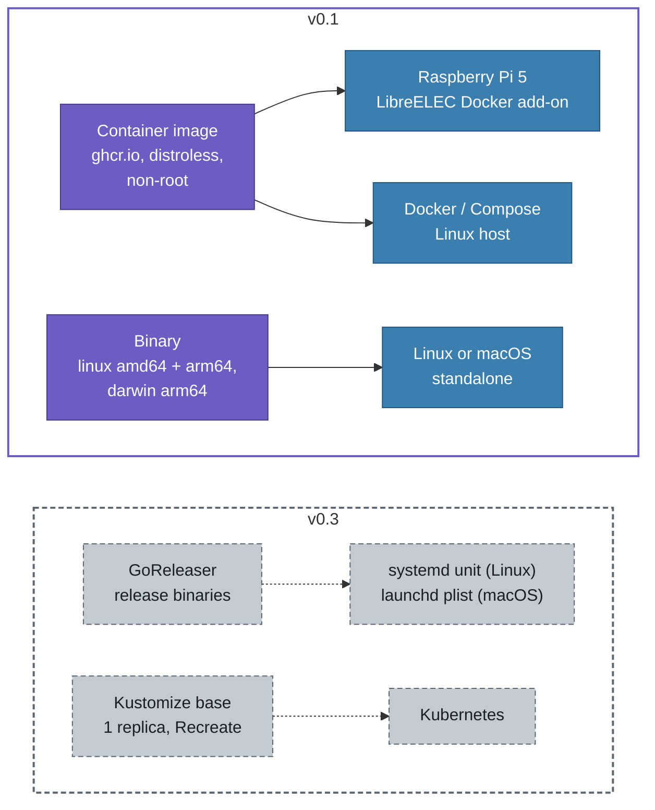

- **One instance only**: tunnel state lives in memory, and VPN providers
  often limit connections per key ([deploy.md](deploy.md)).
- Every variant uses the same config layout (spec 5.1) and env vars,
  default `/etc/wg-stream-proxy` (mounted read-only in the container).
  Tunnel files must be readable by the process but not world-readable.
  The signing key comes from `WG_STREAM_PROXY_SIGNING_KEY_FILE` or
  `WG_STREAM_PROXY_SIGNING_KEY`; without one, `/r/` URLs do not survive a
  restart.
- The process needs no root and no capabilities: the tunnels are in
  userspace, so there is no TUN device and no routing table change.
- LAN use only; exposing it to the internet needs an authenticating
  reverse proxy (spec 8).
- Details per variant: [deploy.md](deploy.md).

## 11. Glossary

| Term | Meaning |
|---|---|
| Channel | One entry of the channel list: name, upstream URL, route, playlist attributes. Configured in `channels.d/*.toml`. |
| Upstream | The server the stream really comes from (broadcaster CDN, radio server), and its URL. |
| Route | How a channel reaches its upstream: through a named tunnel or `direct`. One per tunnel file plus `direct`, each with its own HTTP client. |
| Tunnel | A userspace WireGuard connection (`wireguard-go` + gVisor netstack) built from one `tunnels/*.conf` file. Shared by all channels using it. |
| `direct` | The reserved route over the host's normal network. Used only when written in the config. |
| Guard | The private-range guard: checks the resolved IP before every upstream dial and blocks LAN, loopback and similar ranges unless allowed per route. |
| Fail closed | When something is wrong (no route, tunnel down, unsafe playlist), the request fails; it never falls back to a less safe path. |
| Resource URL | A signed `/r/{channel}/{sig}/{b64url}/{name}` URL that replaces an upstream URL inside a rewritten playlist. |
| Signing key | The secret for the HMAC signature of resource URLs, so `/r/` only fetches URLs that came from a rewritten playlist of that channel. |
| Control plane | Config, reload, tunnel lifecycle, signing key, health and metrics. |
| Data plane | The request path: channel list, `/c/`, `/r/`, raw pipe. |
| Observability plane | `/healthz`, `/metrics` and what feeds them. Section 3 counts it to the control plane; section 7 draws it on its own. |
| Generation | One loaded config with the routes built for it. A request uses the generation it started with; a reload swaps in the next one for new requests. |
