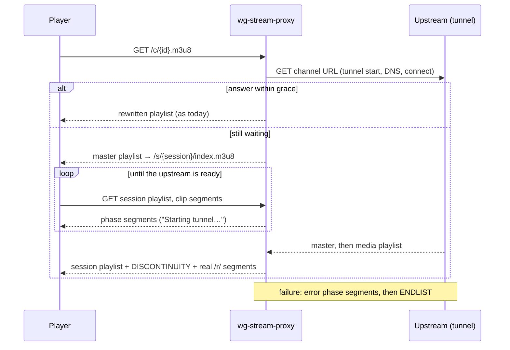
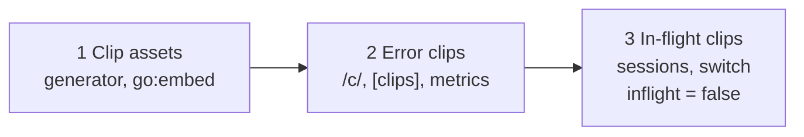

# wg-stream-proxy - In-flight and error clips

Design for the clips (error clips: v0.3; in-flight clips: parked, Later; [spec 10](spec.md#10-roadmap), [#83](https://github.com/KingOfKalk/wg-stream-proxy/issues/83), [#105](https://github.com/KingOfKalk/wg-stream-proxy/issues/105)). Companion to [spec.md](spec.md), [architecture.md](architecture.md) and [observability.md](observability.md).

- Status: error clips are implemented. **In-flight clips are parked** (owner decision 2026-11-19, [#116](https://github.com/KingOfKalk/wg-stream-proxy/issues/116)): the design text below stays for a later start, but nothing is built and the `[clips]` table has only `error`. The settings `inflight` and `grace` that earlier drafts planned do not exist; they come back with the implementation. Spec sentences come with the implementation PRs (section 11).
- Findings are from ffmpeg and VLC in throwaway containers (section 4) and from the Kodi sources (section 5). Kodi itself was not run.
- Decisions: [section 10](#10-decisions); implementation plan: [section 11](#11-implementation-plan).

## Contents

1. [Summary](#1-summary)
2. [Terms](#2-terms)
3. [Today](#3-today)
4. [Prototype](#4-prototype)
5. [Kodi: what the sources say](#5-kodi-what-the-sources-say)
6. [Design](#6-design)
7. [Distribution](#7-distribution)
8. [Is the in-flight clip worth it?](#8-is-the-in-flight-clip-worth-it)
9. [Manual test on the Raspberry Pi](#9-manual-test-on-the-raspberry-pi)
10. [Decisions](#10-decisions)
11. [Implementation plan](#11-implementation-plan)

## 1. Summary

- **Error clips** are cheap: a short VOD playlist with a still image and a text instead of `502`/`504`. Stateless, no switchover. Both test players play it and stop.
- **In-flight clips** need a switchover behind `#EXT-X-DISCONTINUITY`, and that makes the proxy stateful: one stitched media playlist per viewer for the whole viewing (a *clip session*).
- The switchover works in ffmpeg (libavformat, Kodi's default HLS path) and VLC when clip and stream are both MPEG-TS and the clip has an audio track. It fails with fMP4 streams in both players, and ffmpeg loses the audio when the clip has none.
- Kodi's `inputstream.adaptive` reopens all decoders at every discontinuity; its maintainers call discontinuities "not well supported", and a Raspberry Pi 4 user reports a permanent stall there (November 2026). Only a test on the Pi tells.
- The clip costs time: the real picture comes about 3 s after the upstream is ready (the clip segments the player already holds). It pays off only when cold starts are long.
- Decided: error clips first; in-flight clips only for MPEG-TS channels, built but off by default until the Pi test (section 9) passes; the v0.2 timing data (section 8) shows where they help. In-flight clips are parked ([#116](https://github.com/KingOfKalk/wg-stream-proxy/issues/116)); prefetch ([#84](https://github.com/KingOfKalk/wg-stream-proxy/issues/84)) waits for timing data.

## 2. Terms

| Term | Meaning |
|---|---|
| In-flight clip | Still image with a status text ("Starting tunnel…") while a channel starts |
| Error clip | Still image with an error text ("Tunnel not reachable") instead of an HTTP error |
| Phase segment | One pre-rendered clip segment per text, 0.96 s, MPEG-TS |
| Clip session | One viewer's stitched media playlist: clip segments, then `#EXT-X-DISCONTINUITY`, then the real segments |
| Switch | The point where the session appends the real segments |
| Grace | How long `/c/` waits for the upstream before it starts a clip session |

## 3. Today

### 3.1 Where a cold start waits

`GET /c/{id}` blocks until the upstream answers (spec 3.1); Kodi shows its busy spinner meanwhile.

| Wait | Bound (spec) | Measured by (spec 7.3) |
|---|---|---|
| Tunnel start: device up, first handshake | `connect_timeout` (10 s), shared with DNS and connect | `wsp_tunnel_start_seconds{tunnel}` |
| Tunnel DNS, TCP connect | the same `connect_timeout` | `wsp_upstream_phase_seconds{phase="dns"\|"connect"}` |
| TLS handshake | `header_timeout` | `wsp_upstream_phase_seconds{phase="tls"}` |
| First upstream byte | `header_timeout` (15 s from the request start) | `wsp_upstream_phase_seconds{phase="first_byte"}` (includes DNS, connect, TLS) |
| Player start: media playlist, first segments | none (warm route now) | `wsp_upstream_phase_seconds` of the following `/r/` requests |

- The proxy can bridge only the rows above the last: there is nothing to play before the upstream answers. The last row is the player's own start; a clip hides it only because it runs in parallel to the clip.
- Worst case for `/c/`: 15 s, then `504`.

### 3.2 What a failing channel returns

| Failure | Today (spec 3.4) | `reason` | Error clip (proposed) |
|---|---|---|---|
| Tunnel start fails, no handshake (`tunnel.ErrUnavailable`) | `502` | `connect` | Tunnel not reachable |
| Guard refusal (`route.ErrBlocked`), address outside `AllowedIPs` (`tunnel.ErrNotAllowed`) | `502` | `guard`, `connect` | Channel blocked by configuration |
| Tunnel DNS fails, CDN connect fails, TLS error, redirects, size | `502` | `connect`, `tls`, `redirects`, `size` | Channel not available |
| Timeout before the headers | `504` | `timeout` | Channel not available |
| Upstream `5xx`, other non-`2xx`/`4xx` | `502` | — | Channel not available |
| Upstream `4xx` (e.g. geo-block `403`, `404`) | passed through | — | Channel not available |
| Playlist rejected (fail closed, spec 3.2) | `502` | `other` | Channel not available |
| Unknown or disabled channel | `404` | — | none: stays `404` |

Kodi shows the same for all of them: the dialog "Playback failed - One or more items failed to play. Check the log for more information about this message." (Kodi 21: [Application.cpp](https://github.com/xbmc/xbmc/blob/f8815ee40f49a700c047982d752be4b2a61420e2/xbmc/application/Application.cpp#L3068-L3070), strings 16026/16027).

## 4. Prototype

### 4.1 Setup

- One throwaway image with Alpine 3.24 packages, the same base as [`testdata/media/generate.sh`](../testdata/media/generate.sh): `alpine:3.24.4`, `ffmpeg=8.1.3-r0`, `vlc=3.0.23-r4` (headless `cvlc`, runs as non-root), `python3` (test server), `font-inter=4.1-r2`. Versions looked up on 2026-11-19 at Docker Hub (`library/alpine` tags) and with `apk policy` in the image.
- The "real" stream is the `ts` and `fmp4` fixture: H.264 Baseline 192x108, 25 fps, AAC mono 48 kHz, 2 s segments.
- One container at a time; the test server runs inside it on loopback.
- VLC exits 0 even when playback fails (testing.md, L4), so VLC runs were judged by wall time against the content length and by its log (`-vv`).

<details>
<summary>Commands (run from the repository root)</summary>

```sh
printf 'FROM alpine:3.24.4\nRUN apk add --no-cache ffmpeg=8.1.3-r0 vlc=3.0.23-r4 python3 font-inter=4.1-r2\n' |
  docker build -t wsp-clips-proto -
mkdir -p /tmp/clips && cp -r testdata/media/ts testdata/media/fmp4 /tmp/clips/ && cd /tmp/clips
run() { docker run --rm --user "$(id -u):$(id -g)" -e HOME=/tmp -v "$PWD":"$PWD" -w "$PWD" wsp-clips-proto "$@"; }
F=/usr/share/fonts/inter/InterVariable.ttf

# A clip like the fixture: 6 s, 2 s segments, H.264 Baseline 192x108, AAC mono 48 kHz.
mkdir -p clip
run ffmpeg -hide_banner -loglevel error -y \
  -f lavfi -i "color=c=0x101010:size=192x108:rate=25:duration=6,drawtext=fontfile=$F:text='Starting':fontcolor=white:fontsize=h/8:x=(w-tw)/2:y=(h-th)/2" \
  -f lavfi -i anullsrc=r=48000:cl=mono -shortest \
  -c:v libx264 -preset veryfast -profile:v baseline -pix_fmt yuv420p -g 50 -keyint_min 50 -sc_threshold 0 \
  -c:a aac -b:a 32k -ac 1 -ar 48000 \
  -f hls -hls_time 2 -hls_playlist_type vod -hls_segment_filename clip/c%d.ts clip/index.m3u8

# Stitched VOD playlist: 3 clip segments, the tag, 6 real segments.
{ printf '#EXTM3U\n#EXT-X-VERSION:3\n#EXT-X-TARGETDURATION:2\n#EXT-X-PLAYLIST-TYPE:VOD\n'
  for i in 0 1 2; do printf '#EXTINF:2.0,\nclip/c%d.ts\n' "$i"; done
  echo '#EXT-X-DISCONTINUITY'
  for i in 0 1 2 3 4 5; do printf '#EXTINF:2.0,\nts/seg%d.ts\n' "$i"; done
  echo '#EXT-X-ENDLIST'; } > case.m3u8

# Play it with ffmpeg (frames, sizes, timestamps per frame) and VLC.
run sh -c 'python3 -m http.server 8000 --bind 127.0.0.1 >/dev/null 2>&1 & sleep 1
  ffmpeg -hide_banner -i http://127.0.0.1:8000/case.m3u8 -map 0:v? -map 0:a? \
    -vf showinfo -af ashowinfo -fps_mode passthrough -f null - 2> ffmpeg.log
  time cvlc -vv --intf dummy --vout dummy --aout dummy --play-and-exit \
    http://127.0.0.1:8000/case.m3u8 2> vlc.log'
grep -c 'Parsed_showinfo.* n:' ffmpeg.log        # decoded video frames (450 expected)
grep 'Ending demuxer stream' vlc.log              # VLC saw the discontinuity
```

The other cases change the clip command: `size=1280x720` and `-profile:v high` (resolution), `rate=50 -g 100` (frame rate), `anullsrc=r=44100:cl=stereo` with `-ac 2 -ar 44100` (audio), no `anullsrc` and `-an` (no audio), `-c:v libx265` (HEVC), `-hls_segment_type fmp4` (fMP4 clip); the real side: `-c copy -output_ts_offset 36000` (timestamps +10 h), `-c copy -mpegts_start_pid 0x31 -mpegts_pmt_start_pid 0x30` (other PIDs), the `fmp4` fixture with `#EXT-X-MAP` after the tag.

</details>

### 4.2 Switchover matrix

Stitched VOD playlists: 3 clip segments, `#EXT-X-DISCONTINUITY`, the 6 fixture segments (450 video frames in total). Unless named, the clip matches the fixture: MPEG-TS, H.264, AAC mono 48 kHz, timestamps restarting at the tag.

| # | Clip → real | ffmpeg 8.1.3 | VLC 3.0.23 |
|---|---|---|---|
| 1 | Same parameters | Plays (432-437 of 450 frames over several runs; one TS packet flagged corrupt at the switch: continuity counter) | Plays; restarts demuxer and decoders at the tag |
| 2 | Same, **without the tag** | Same as 1: the tag is ignored | Broken: 286 "late" warnings, ends after 12 of 18 s |
| 3 | 1280x720 High → 192x108 Baseline | Plays; filter graph reconfigured | Plays |
| 4 | 50 fps → 25 fps | Plays | Plays |
| 5 | AAC stereo 44.1 kHz → mono 48 kHz | Plays; non-monotonic audio DTS warnings | Plays |
| 6 | **No audio track** → audio | Real audio lost (new stream ignored, 0 audio frames) | Plays with audio |
| 7 | **HEVC** → H.264 | Real video not decoded (HEVC decoder kept) | Plays |
| 8 | Timestamps jump +10 h | Plays (corrects the jump) | Plays |
| 9 | Other PIDs and PMT | Plays (449 frames) | Plays |
| 10 | TS → **fMP4** (`#EXT-X-MAP` after the tag) | Only the clip; real stream not decoded | Hangs until killed |
| 11 | **fMP4 → fMP4**, same parameters | Plays, one segment lost ("Found duplicated MOOV Atom. Skipped it") | Stops after 5 of 18 s |
| 12 | **fMP4** 1080p → fMP4 192x108 | Corrupt picture: real stream decoded with the clip's SPS | Stops after 2 s |
| 13 | fMP4 → TS | Only the clip | Plays |

- The tag is required for VLC and harmless for ffmpeg. ffmpeg's HLS demuxer does not parse it at all (`hls.c` [n8.1.3](https://github.com/FFmpeg/FFmpeg/blob/n8.1.3/libavformat/hls.c) has no `DISCONTINUITY` tag handling; `AVFMT_TS_DISCONT` only marks the format).
- ffmpeg probes the container once and keeps one demuxer for the whole playlist ([n9.0.2 L2473ff](https://github.com/FFmpeg/FFmpeg/blob/n9.0.2/libavformat/hls.c#L2473)); a second `moov` is skipped. VLC 3 keeps one init segment per playlist (its log lists a single `InitSegment`). So a clip can only precede an **MPEG-TS** stream.
- The clip must carry **H.264 and an AAC track**. Resolution, frame rate and audio layout may differ.
- The ffmpeg results are from the ffmpeg CLI, which also repairs timestamp jumps. Kodi uses libavformat with its own player (section 5).

### 4.3 Live switchover

A small test server played the part of a clip session:

- Phase segments of 0.96 s, three listed at once, then one more every 0.96 s; each segment shows the phase current when the player requests it.
- The same phase segment is served again and again: its PTS, DTS and PCR are shifted to its position and the TS continuity counters continue (section 6.3).
- 4 s after the first request the "upstream" is ready: the next playlist appends `#EXT-X-DISCONTINUITY` and 3 real segments, then one more every 2 s. Window of 6 segments; `#EXT-X-DISCONTINUITY-SEQUENCE` goes to 1 when the tag leaves the window.

| Run | Playlist with the switch fetched | First real segment fetched | Result |
|---|---|---|---|
| ffmpeg `-re`, silent AAC | 5.2 s | 7.1 s | All 300 real frames and the audio decoded; resolution 1920x1080 → 192x108 |
| ffmpeg, clip without audio | 4.2 s | 6.1 s | Real audio lost (as case 6) |
| ffmpeg, target duration 1 → 2 at the switch | 5.2 s | 7.1 s | Plays |
| VLC, silent AAC | 4.1 s | 4.1 s (fetches ahead) | Plays; no late frames; real picture at about 6.8 s |
| VLC, clip without audio | 4.1 s | 4.1 s | Plays with audio |
| VLC, without the tag | 4.1 s | 4.1 s | Broken, ends after 15 of 19 s |
| VLC, target duration 1 → 2 at the switch | 4.1 s | 4.1 s | Plays; 2 late pictures at the switch |

- Switch latency: the real picture comes about **3 s after the upstream is ready**: the player first plays the clip segments it already holds (three listed at once, 3 × 0.96 s).
- Reloads: ffmpeg reloads the playlist when it runs out of segments (reload interval = last segment duration, [`default_reload_interval`](https://github.com/FFmpeg/FFmpeg/blob/n8.1.3/libavformat/hls.c#L1532-L1537)); VLC every target duration; `inputstream.adaptive` every target duration and keeps the smallest value it has seen ([HLSTree.cpp L587-L596](https://github.com/xbmc/inputstream.adaptive/blob/81fd9be3a634c3c212866680707dff8d540e14a5/src/parser/HLSTree.cpp#L587-L596)).
- Status latency: a phase shows up 1 segment (ffmpeg, fetches just in time) to 2 segments (VLC, fetches ahead) after it began, so about 1-2 s. A phase shorter than one segment may never be seen.
- Phase segments with the same encoder settings follow each other without a tag: same SPS/PPS, each starts with an IDR frame. VLC restarted its decoders only at the switch.
- The test reused the phase segments of 4.4, whose silent AAC had 46 packets for 45 frames' worth of audio; ffmpeg warned about one duplicate audio DTS at every joint. The generator must cut exactly 45 AAC frames per segment (section 6.4).

<details>
<summary>Live publisher for a manual test (no timestamp shifting needed)</summary>

A 11.52 s clip in 0.96 s segments with three texts, then the `ts` fixture. Run from `/tmp/clips` of 4.1.

```sh
mkdir -p lv/clip && cp -r ts lv/
dt() { echo "drawtext=fontfile=$F:text='$1':fontcolor=0xE0E0E0:fontsize=64:x=(w-tw)/2:y=(h-th)/2:enable='$2'"; }
run ffmpeg -hide_banner -loglevel error -y \
  -f lavfi -i "color=c=0x101010:size=1920x1080:rate=25:duration=11.52,$(dt 'Starting tunnel…' 'lt(t,1.92)'),$(dt 'Connecting to channel…' 'between(t,1.92,3.84)'),$(dt 'Waiting for stream…' 'gte(t,3.84)'),format=yuv420p" \
  -f lavfi -i anullsrc=r=48000:cl=stereo -t 11.52 \
  -c:v libx264 -preset veryfast -tune stillimage -profile:v high -g 24 -keyint_min 24 -sc_threshold 0 -bf 0 \
  -c:a aac -b:a 64k -ac 2 -ar 48000 \
  -f hls -hls_time 0.96 -hls_segment_filename lv/clip/c%d.ts lv/clip/index.m3u8
cat > lv/live.sh <<'EOF'
#!/bin/sh
# Writes live.m3u8 like a clip session: 3 clip segments at once, one more
# every 0.96 s until READY seconds, then the tag and the 6 fixture segments
# (3 at once, then one every 2 s), then ENDLIST.
set -eu
READY=${READY:-5}
seg() { printf '#EXTINF:%s,\n%s\n' "$1" "$2" >> list; }
pub() { { printf '#EXTM3U\n#EXT-X-VERSION:3\n#EXT-X-TARGETDURATION:2\n#EXT-X-MEDIA-SEQUENCE:0\n'; cat list; } > live.tmp; mv live.tmp live.m3u8; }
: > list
for n in 0 1 2; do seg 0.960 clip/c$n.ts; done; pub
n=3 start=$(date +%s)
while [ $(( $(date +%s) - start )) -lt "$READY" ] && [ -e clip/c$n.ts ]; do
  sleep 0.96; seg 0.960 clip/c$n.ts; pub; n=$((n + 1))
done
echo '#EXT-X-DISCONTINUITY' >> list
for j in 0 1 2; do seg 2.000 ts/seg$j.ts; done; pub
for j in 3 4 5; do sleep 2; seg 2.000 ts/seg$j.ts; pub; done
echo '#EXT-X-ENDLIST' >> list; pub
EOF
cd lv && run sh -c 'python3 -m http.server 8000 --bind 127.0.0.1 >/dev/null 2>&1 & sh live.sh & sleep 0.3
  ffmpeg -hide_banner -re -i http://127.0.0.1:8000/live.m3u8 -f null - 2> ../live-ffmpeg.log'
```

ffmpeg decoded all 492 frames (192 clip, 300 real) with audio; VLC played it in real time and logged one discontinuity.

</details>

### 4.4 Clip size

Full HD phase segments, 0.96 s, `libx264 -preset slow -tune stillimage -crf 28`, one IDR frame each, near-black background, white text (Inter):

| Text | MPEG-TS with silent AAC | MPEG-TS without audio | fMP4 with silent AAC |
|---|---|---|---|
| Starting tunnel… | 12.4 KB | 11.5 KB | 7.9 KB |
| Connecting to channel… | 13.7 KB | 12.8 KB | 9.3 KB |
| Waiting for stream… | 13.5 KB | 12.6 KB | 9.1 KB |
| Tunnel not reachable | 13.2 KB | 12.2 KB | 8.8 KB |
| Channel not available | 13.3 KB | 12.4 KB | 8.9 KB |
| Channel blocked by configuration | 15.6 KB | 14.7 KB | 11.0 KB |
| **All six** | **82 KB** | 76 KB | 55 KB |

### 4.5 Radio error stream

A silent MP3 (32 kbit/s mono) with ICY metadata `StreamTitle='Tunnel not reachable';` every 8192 bytes:

- VLC sent `Icy-MetaData: 1`, logged `New Icy-Title=Tunnel not reachable` and shows it as "Now playing".
- ffmpeg logged `Metadata update for StreamTitle: Tunnel not reachable`.
- When the stream ended, VLC reconnected at once, again and again: 699 requests in 20 s. A radio error stream must not end; it plays silence until the player stops.

## 5. Kodi: what the sources say

Not tested on a device. Code read at Kodi 21 Omega [`f8815ee`](https://github.com/xbmc/xbmc/tree/f8815ee40f49a700c047982d752be4b2a61420e2) and 22 Piers [`51b30cf`](https://github.com/xbmc/xbmc/tree/51b30cf19be95a6f1568f7a4aed71186b84af3e2), `inputstream.adaptive` (ISA) 22.3.24-Piers+ [`81fd9be`](https://github.com/xbmc/inputstream.adaptive/tree/81fd9be3a634c3c212866680707dff8d540e14a5) and 21.5.26-Omega [`2340850`](https://github.com/xbmc/inputstream.adaptive/tree/23408503aa0330e5b731977f451bbacf32992e4f), `pvr.iptvsimple` [`7ff561d`](https://github.com/kodi-pvr/pvr.iptvsimple/tree/7ff561d077589fad57a3dcfdc3fca678584449e1).

### 5.1 Which player plays a channel

- IPTV Simple Client hands HLS to Kodi's ffmpeg by default (`useInputstreamAdaptiveforHls` is off, [settings.xml](https://github.com/kodi-pvr/pvr.iptvsimple/blob/7ff561d077589fad57a3dcfdc3fca678584449e1/pvr.iptvsimple/resources/settings.xml#L369-L371), [StreamUtils.cpp](https://github.com/kodi-pvr/pvr.iptvsimple/blob/7ff561d077589fad57a3dcfdc3fca678584449e1/src/iptvsimple/utilities/StreamUtils.cpp#L96-L121)).
- With `#KODIPROP:inputstream=inputstream.adaptive` ISA plays it. [deploy.md](deploy.md#hls-channels-in-kodi) recommends that on the Pi ([#72](https://github.com/KingOfKalk/wg-stream-proxy/issues/72)), so the clip has to work there first.
- Kodi bundles FFmpeg 6.0.1 (Omega) and 9.0.2 (Piers) ([FFMPEG-VERSION Omega](https://github.com/xbmc/xbmc/blob/f8815ee40f49a700c047982d752be4b2a61420e2/tools/depends/target/ffmpeg/FFMPEG-VERSION), [Piers](https://github.com/xbmc/xbmc/blob/51b30cf19be95a6f1568f7a4aed71186b84af3e2/tools/depends/target/ffmpeg/FFMPEG-VERSION)). LibreELEC may build its own; not checked.

### 5.2 Kodi's ffmpeg path

- libavformat ignores the tag and keeps one demuxer (4.2). Live playback starts 3 segments before the end of the playlist (`live_start_index = -3`, [hls.c](https://github.com/FFmpeg/FFmpeg/blob/n8.1.3/libavformat/hls.c#L2822-L2823)).
- Kodi's demuxer rebuilds its streams when the stream count, a codec, the audio channels or the extradata change, and sends a stream change to the player ([DVDDemuxFFmpeg.cpp, Omega](https://github.com/xbmc/xbmc/blob/f8815ee40f49a700c047982d752be4b2a61420e2/xbmc/cores/VideoPlayer/DVDDemuxers/DVDDemuxFFmpeg.cpp#L1087-L1100)). A per-packet check also compares width, height, sample rate and channels ([L1205-L1236](https://github.com/xbmc/xbmc/blob/f8815ee40f49a700c047982d752be4b2a61420e2/xbmc/cores/VideoPlayer/DVDDemuxers/DVDDemuxFFmpeg.cpp#L1205-L1236)).
- Kodi's player corrects timestamp jumps forward (> 1 s) and backward (> 0.5 s Omega, 1 s Piers) when audio and video jump together ([`CheckContinuity`, Omega](https://github.com/xbmc/xbmc/blob/f8815ee40f49a700c047982d752be4b2a61420e2/xbmc/cores/VideoPlayer/VideoPlayer.cpp#L2297-L2371)). Clip and stream each have aligned audio and video, so they do.
- Unknown: whether Kodi picks up the real audio when the clip has none (the ffmpeg CLI did not, case 6). Another reason for the silent AAC track.

### 5.3 inputstream.adaptive

- Every `#EXT-X-DISCONTINUITY` starts a new period ([HLSTree.cpp L763-L830](https://github.com/xbmc/inputstream.adaptive/blob/81fd9be3a634c3c212866680707dff8d540e14a5/src/parser/HLSTree.cpp#L763-L830)). At the end of a period ISA builds new streams and sends a stream change, so Kodi reopens the decoders even if nothing changed ([main.cpp L420-L435](https://github.com/xbmc/inputstream.adaptive/blob/81fd9be3a634c3c212866680707dff8d540e14a5/src/main.cpp#L420-L435)).
- Container and init segment carry over into the next period until a new `#EXT-X-MAP` ([L819-L826](https://github.com/xbmc/inputstream.adaptive/blob/81fd9be3a634c3c212866680707dff8d540e14a5/src/parser/HLSTree.cpp#L819-L826)).
- `#EXT-X-DISCONTINUITY-SEQUENCE` drops older periods; a sequence without a matching period logs "Period of discontinuity %u not found" ([L701-L762](https://github.com/xbmc/inputstream.adaptive/blob/81fd9be3a634c3c212866680707dff8d540e14a5/src/parser/HLSTree.cpp#L701-L762)).
- Live start: at least 16 s before the end of the first period; a shorter first period plays from its first segment ([AdaptiveTree.cpp L119-L127](https://github.com/xbmc/inputstream.adaptive/blob/81fd9be3a634c3c212866680707dff8d540e14a5/src/common/AdaptiveTree.cpp#L119-L127)). A clip of a few segments therefore plays from its start.
- Status: the wiki says "ADS breaks are not well supported, playback freezes or crashes may occurs" ([Add-on WIP status](https://github.com/xbmc/inputstream.adaptive/wiki/Add%E2%80%90on-WIP-status)).
- Reports (not reproduced):
  - [#2136](https://github.com/xbmc/inputstream.adaptive/issues/2136) (open, November 2026): crash at a live discontinuity on a Shield; a comment from a Raspberry Pi 4 (Kodi 21.3, ISA 21.5.9 and 21.5.16, H.264 + AAC) reports a permanent stall at the first discontinuity.
  - [#1228](https://github.com/xbmc/inputstream.adaptive/issues/1228) (open): a stall of several seconds at every period change on a weak device.
  - Fixed in Omega 21.4.x: freezes and stops at HLS ad breaks ([#1431](https://github.com/xbmc/inputstream.adaptive/pull/1431), [#1562](https://github.com/xbmc/inputstream.adaptive/pull/1562)).

### 5.4 Radio and error dialogs

- Kodi opens an HTTP stream with `icy-name`, `icy-br` or `icy-notice1` headers as a Shoutcast stream ([CurlFile.cpp](https://github.com/xbmc/xbmc/blob/51b30cf19be95a6f1568f7a4aed71186b84af3e2/xbmc/filesystem/CurlFile.cpp#L1196-L1204)), asks for `Icy-MetaData=1` and shows `StreamTitle` as the title; "artist - title" is split ([ShoutcastFile.cpp](https://github.com/xbmc/xbmc/blob/51b30cf19be95a6f1568f7a4aed71186b84af3e2/xbmc/filesystem/ShoutcastFile.cpp#L184-L312)). Whether PVR radio channels take this path was not checked.
- An HLS error clip replaces the "Playback failed" dialog with the clip; Kodi stops at `#EXT-X-ENDLIST`. ISA rejects a playlist with `ENDLIST` and no segments ([#1507](https://github.com/xbmc/inputstream.adaptive/issues/1507)), so an error playlist always has segments.

## 6. Design

### 6.1 Overview



### 6.2 Error clips

- Where: `GET /c/` of channels listed with `.m3u8` (spec 6: HLS by config or URL). `HEAD`, `/r/` (segments, sub-playlists, keys) and other channels keep their HTTP errors: a failed segment is the player's to retry or skip, and tools want the status.
- Answer: `200`, `Content-Type: application/vnd.apple.mpegurl`, `Cache-Control: no-store`, a VOD media playlist (`#EXT-X-PLAYLIST-TYPE:VOD`, `#EXT-X-ENDLIST`) with the error segment 5 times (4.8 s), timestamps shifted per position (6.3).
- Segment URLs: `/clip/{name}/{n}.ts`, `{name}` one of the built-in clips, `{n}` the position (0-63). Unsigned and outside `/r/`: they reach no upstream.
- Class per failure: [section 3.2](#32-what-a-failing-channel-returns).
- Logs and metrics count the failure as today; the warn line gets `clip=<name>`.
- Stateless: no session, no switchover. Prototype: the "Tunnel not reachable" segment 5 times with shifted timestamps; ffmpeg decoded 120 frames (4.8 s), VLC played 5 s, then both stopped.

### 6.3 In-flight clips

> **Parked** ([#116](https://github.com/KingOfKalk/wg-stream-proxy/issues/116)): not built, no setting and no behaviour in the code. The text below is the design for a later start. Where it mentions `grace` or `inflight`, those settings do not exist yet; the `[clips]` table has only `error`.

**Entry and grace**

- Only `GET /c/` of HLS channels, only while the channel is known to be MPEG-TS with muxed audio (see *Limits*).
- `/c/` waits up to the grace (default `1s`). A channel that answers in time is served as today: stateless, no session, no added latency.
- Otherwise `/c/` answers a master playlist with one variant: `/s/{session}/index.m3u8`. `{session}`: 128 random bits. A master is needed because the player reloads the URL it was given, and `/c/` cannot tell viewers apart.

**Session playlist before the switch**

- `#EXT-X-TARGETDURATION:1`, `#EXT-X-MEDIA-SEQUENCE` and `#EXT-X-DISCONTINUITY-SEQUENCE` from 0.
- Three phase segments listed at once, one more every 0.96 s, at most 6 in the window. Players start about three segments or target durations before the end ([RFC 8216 6.3.3](https://www.rfc-editor.org/rfc/rfc8216#section-6.3.3), ffmpeg `live_start_index`), so they start at the first clip segment.
- Segment `n` is `/s/{session}/{n}.ts`: the phase segment of the phase current when the player asks for it, PTS/DTS/PCR shifted by `n × 0.96 s`, TS continuity counters continued from segment `n-1`. The rewrite touches only fixed header fields: about a hundred lines of Go and a fuzz target (L2). fMP4 would need `tfdt` and `mfhd` patches as well; not needed (TS only).
- Phases from the request trace the server already records (`tunnel.WithStartTrace`, `route.Trace`): `Starting tunnel…` while the tunnel starts, `Connecting to channel…` during DNS, connect and TLS, `Waiting for stream…` from the request until the real media playlist is in.

**Switch**

- When the upstream master arrives: pick the variant (highest `BANDWIDTH`), fetch its media playlist. Only then switch.
- Append, never rewrite ([RFC 8216 6.2.1](https://www.rfc-editor.org/rfc/rfc8216#section-6.2.1)): after the last listed clip segment, `#EXT-X-DISCONTINUITY`, then the last 3 upstream segments (the player's own start point), as rewritten `/r/` URLs.
- Every later reload: fetch the upstream media playlist, rewrite it, renumber: session sequence = upstream sequence + the offset fixed at the switch. `#EXT-X-DISCONTINUITY-SEQUENCE` = 1 once the tag has left the window, plus the upstream's own increments.
- `#EXT-X-TARGETDURATION` becomes the upstream's value. RFC 8216 6.2.1 says it "MUST NOT change"; ffmpeg and VLC accept it (4.3), ISA keeps its 1 s reload interval. The compliant alternative, a fixed 10 from the start, would cost up to 10 s of latency (decision 12).
- The real segments are streamed unchanged through `/r/` (spec 4); prefetch (#84) applies to them as to any `/r/` request.

**Failure during a session**

- The session appends the error phase segment 5 times (same encoding, no tag) and `#EXT-X-ENDLIST`: the text changes from "Waiting for stream…" to the error, then playback ends.

**End of a session**

- No reload for 30 s (3 × the longest target duration, at least 30 s): the session is dropped. Its `/s/` URLs then give `404`.
- Upstream media sequence going backwards, or a reload that removes or disables the channel: `404` (like `/r/`, spec 4).
- Sessions live in memory: a restart ends them and the player stops (today `/r/` URLs survive a restart with a fixed signing key). At most 16 sessions; the oldest goes first.

**Limits**

- MPEG-TS with muxed audio only (4.2). fMP4 streams and variants with a separate audio rendition (`#EXT-X-MEDIA:TYPE=AUDIO,URI=…`) cannot be stitched: the container or the audio track is only known after the switch.
- So the proxy remembers per channel, in memory, what the last successful start returned (container, separate audio). A channel without that memory gets no in-flight clip (decision 9). If a remembered channel has changed and turns out unsuitable, the session ends with `#EXT-X-ENDLIST` after the clip, the player stops, and the memory is updated, so the next start runs without a clip.
- ABR is lost for the session: one variant for the whole viewing.

### 6.4 Clip format

| Property | Value | Why |
|---|---|---|
| Container | MPEG-TS | fMP4 cannot precede anything in ffmpeg or VLC (4.2) |
| Video | H.264 High, level 4.0, 1920x1080, 25 fps, `yuv420p`, one IDR per segment, no B-frames | HEVC breaks the switch in ffmpeg (case 7); a still needs no B-frames |
| Audio | AAC-LC stereo 48 kHz, silent, 64 kbit/s | Without a track ffmpeg drops the real audio (case 6); layout and rate may differ from the stream (case 5) |
| Segment | 0.96 s = 24 frames = exactly 45 AAC frames | Audio and video end together, so repeated segments join without gap or overlap |
| Look | near-black (`#101010`), one centered English text, `#E0E0E0`, 64 px, no animation | owner (decided) |
| Size | 12-16 KB per text, 82 KB for six (4.4) | |

- Timestamps start at 0 in the file; the proxy shifts them per position.
- The generator checks every segment with `ffprobe`: 24 video frames, 45 audio frames, one IDR at the start, identical SPS/PPS across texts.

### 6.5 Radio and raw channels

- In-flight clips: none. A raw stream has no tag to switch formats, and the station's codec is only known from its first bytes.
- Error stream (later step, after the video clips), for channels with `radio = "true"` in `playlist.attrs` (the attribute that puts them in Kodi's radio section, deploy.md):
  - `200`, `Content-Type: audio/mpeg`, `icy-name: wg-stream-proxy`;
  - silent MP3 (mono, low bit rate) in a loop, built in, a few KB;
  - with `Icy-MetaData: 1` from the client: `icy-metaint: 8192` and `StreamTitle='<error text>';`;
  - it never ends by itself: VLC reconnects at once when it does (4.5). It ends when the player leaves or after `[tunnels] idle_timeout`.
- Other raw channels (MPEG-TS) keep HTTP errors.

### 6.6 Metrics and logs

Bounded labels only (clip names are fixed, no channel ids on new series):

| Metric | Type | Labels | Meaning |
|---|---|---|---|
| `wsp_clip_sessions_total` | counter | `result` = `switched`, `failed`, `unsuitable`, `abandoned` | How in-flight sessions ended |
| `wsp_clip_switch_seconds` | histogram | — | From `/c/` to the switch (the wait the clip covered) |
| `wsp_error_clips_total` | counter | `clip` | Error clips served, per text |

- Logs: one info line per session when it ends (`channel`, `result`, `wait`, `segments`); the existing failure warn line gets `clip=<name>`.
- `/debug/requests`: `/s/` and `/clip/` requests appear like `/r/` with `kind` `clip`.

### 6.7 Memory and CPU on the Pi

- Binary: about 100 KB more (six TS segments and the MP3).
- Per session: some hundred bytes of state; the upstream media playlist is read and rewritten per reload, as `/r/` does today (bounded by `max_playlist_size`). At most 16 sessions.
- Per clip segment: one 12-16 KB copy for the timestamp rewrite, or none when rewriting while streaming.
- No encoder at runtime: the image stays distroless.

### 6.8 Interaction with #84 and #85

- Prefetch ([#84](https://github.com/KingOfKalk/wg-stream-proxy/issues/84)): clip segments come from memory and are never prefetched. At the switch the session knows the 3 real segments the player will fetch next: the best moment to prefetch them, which shortens the switch.
- File-watch reload ([#85](https://github.com/KingOfKalk/wg-stream-proxy/issues/85)) and `SIGHUP`: a session keeps the channel config of its `/c/` request (spec 5.6); a reload that removes or disables the channel ends it (`404`). Built-in clips are not files, so the watcher needs no new paths. Own clips in the config dir (decision 6) would add `<config-dir>/assets/clips/` to the watched files.

### 6.9 Spec changes (with the implementation)

- 3.2: stateless except clip sessions. 3.4: error clips instead of `502`/`504` on `GET /c/` of HLS channels.
- 5.3: `[clips]` with `error = true` (in-flight clips would add `inflight` and `grace`; parked, [#116](https://github.com/KingOfKalk/wg-stream-proxy/issues/116)). 7.1: `/s/…` and `/clip/…`. 7.3: the metrics of 6.6. 9: package `internal/clips`.
- testing.md: L1 for the timestamp rewrite and the session playlist (injected clock), L2 fuzz target for the TS rewrite, L4 with ffmpeg: in-flight switch and error clip against the fixture server.

## 7. Distribution

Decided (decision 6):

- A generator script, `internal/clips/generate.sh`, like [`testdata/media/generate.sh`](../testdata/media/generate.sh): it re-runs itself in a pinned image (`alpine:3.24.4` with `ffmpeg=8.1.3-r0` today) and renders all clips.
- Font: Inter 4.1 ([release](https://github.com/rsms/inter/releases/tag/v4.1)), fetched by version: `Inter-4.1.zip`, SHA-256 `9883fdd4a49d4fb66bd8177ba6625ef9a64aa45899767dde3d36aa425756b11e`; the script uses `extras/ttf/Inter-Regular.ttf` (SHA-256 `40d692fce188e4471e2b3cba937be967878f631ad3ebbbdcd587687c7ebe0c82`) and checks both.
- The rendered segments are committed (82 KB for six) and embedded with `go:embed`: every binary and the container image carry them, without files, downloads or config.
- Changing a text: edit the script, rerun, commit in a PR.
- Font licence: only rendered pixels ship, not the font. The SIL OFL allows that without conditions ([OFL-FAQ 1.1](https://openfontlicense.org/ofl-faq/): "video titling" is named; artwork is not restricted; acknowledgement not required). The docs credit Inter anyway.
- Repo rules: AGENTS.md and CONTRIBUTING.md do not forbid committed generated files, and `testdata/media` (828 KB, rendered by its script) is the precedent. The output is not byte-reproducible across ffmpeg versions, which is why it is committed rather than rendered at build time.

Rejected alternatives:

| Option | Against |
|---|---|
| Render at Docker or CI build time | ffmpeg in every build, output differs per ffmpeg version, missing in plain `go build` binaries |
| Files in the config dir | more setup for every user; fine later as own clips on top of the built-in ones |

## 8. Is the in-flight clip worth it?

The clip covers the `/c/` wait (3.1) and delays the real picture by about 3 s after the upstream is ready (4.3). Without it, the player's own start (media playlist, first segments) follows the wait; with it, that start runs during the clip. So the clip only helps when the wait is long.

With about a week of v0.2 data from the Pi:

```promql
# p95 tunnel start per tunnel
histogram_quantile(0.95, sum by (le, tunnel) (rate(wsp_tunnel_start_seconds_bucket[7d])))
# p95 time to the first upstream byte per route (includes DNS, connect, TLS)
histogram_quantile(0.95, sum by (le, route) (rate(wsp_upstream_phase_seconds_bucket{phase="first_byte"}[7d])))
# cold starts per tunnel and day
sum by (tunnel) (increase(wsp_tunnel_start_seconds_count[7d])) / 7
```

- Upper bound of a cold `/c/` wait on a route: p95 tunnel start + p95 first byte.
- Worth it when that bound is above about 3 s on a route used often from cold. Below about 1 s (the grace) clip sessions never start.
- Cold starts are rare by design (`idle_timeout` 60 min): usually the first channel of an evening.

## 9. Manual test on the Raspberry Pi

Goal: does Kodi switch from the clip to the stream, with the ffmpeg path and with ISA, and how long does it stall?

**Setup**

1. On any LAN host with Docker, build the files of 4.1 and 4.3 (`case.m3u8`, `lv/`). For an HD stream instead of the 192x108 fixture, render 12 s of `testsrc2=size=1920x1080:rate=25` with `sine` audio into `ts/` the same way (H.264 High, AAC stereo, `-g 50`, `-hls_time 2`). An error playlist needs no stitching; ffmpeg writes it:

   ```sh
   mkdir -p err && run ffmpeg -hide_banner -loglevel error -y \
     -f lavfi -i "color=c=0x101010:size=1920x1080:rate=25:duration=4.8,drawtext=fontfile=$F:text='Channel not available':fontcolor=0xE0E0E0:fontsize=64:x=(w-tw)/2:y=(h-th)/2,format=yuv420p" \
     -f lavfi -i anullsrc=r=48000:cl=stereo -t 4.8 \
     -c:v libx264 -tune stillimage -profile:v high -g 24 -bf 0 -c:a aac -ac 2 -ar 48000 \
     -f hls -hls_time 0.96 -hls_playlist_type vod -hls_segment_filename err/e%d.ts err/index.m3u8
   ```

2. Serve them on the LAN with the prototype image: `docker run --rm -p 8000:8000 -v "$PWD":"$PWD" -w "$PWD" wsp-clips-proto python3 -m http.server 8000`. For the live case also run `sh live.sh` in `lv/`, again before each try.
3. Route them through the proxy as `direct` channels (example host `192.168.1.10`):

```toml
# channels.d/clips-test.toml
tunnel = "direct"
group = "Clips test"

[[channel]]
name = "Clip VOD ffmpeg"
url = "http://192.168.1.10:8000/case.m3u8"

[[channel]]
name = "Clip VOD ISA"
url = "http://192.168.1.10:8000/case.m3u8"
[channel.playlist.extra.KODIPROP]
"inputstream" = "inputstream.adaptive"

[[channel]]
name = "Clip live ISA"
url = "http://192.168.1.10:8000/live.m3u8"
[channel.playlist.extra.KODIPROP]
"inputstream" = "inputstream.adaptive"
```

and in `config.toml`: `[upstream.allow_private] direct = ["192.168.1.0/24"]`. Add the same with the ffmpeg path (no `KODIPROP`) and an error playlist channel.

**Per channel, record**

| Check | Expect |
|---|---|
| Clip visible | text readable, no spinner |
| Switch | picture and sound of the stream; stall in seconds (stopwatch) |
| Audio after the switch | present, in sync |
| Live case | keeps playing for a minute after the switch; no loop back to the clip |
| Error playlist | clip for about 5 s, then back to the channel list without "Playback failed" |
| Kodi log (debug on) | `stream change`, `DEMUX_SPECIALID_STREAMCHANGE`, `Period of discontinuity … not found`, crashes |

Note Kodi, ISA and LibreELEC versions. A stall under 2 s with ISA and no "Period … not found" is a pass.

## 10. Decisions

All decided by the owner on 2026-11-19, following the recommendations of the first draft.

1. **Names**: "in-flight clips" while a channel starts, "error clips" for failures.
2. **Look**: Full HD still, near-black, one centered English text, no animation, font Inter 4.1 (tested here, compact for long texts).
3. **Texts**: "Starting tunnel…", "Connecting to channel…", "Waiting for stream…"; "Tunnel not reachable", "Channel not available", "Channel blocked by configuration". Each maps to one phase or failure class (3.2, 6.3).
4. **Audio**: silent AAC-LC stereo 48 kHz track. Without one, ffmpeg loses the stream's audio after the switch (case 6).
5. **Status per phase**: one 0.96 s segment per phase, chosen when the player asks. The text lags 1-2 s; phases shorter than a segment may not show.
6. **Distribution**: generator script, committed segments, `go:embed` (section 7). Clips in the config dir may come later as an add-on.
7. **Scope and order**: error clips first. In-flight clips are parked ([#116](https://github.com/KingOfKalk/wg-stream-proxy/issues/116)). When built, they stay off until the Pi test (section 9) passes with `inputstream.adaptive` and with Kodi's default player.
8. **Error clips**: only for `GET /c/` of HLS channels, all failure classes of 3.2. `HEAD`, `/r/` and raw channels keep their HTTP errors; logs and metrics keep the cause.
9. **Unsuitable channels**: per-channel memory of the last start's format. fMP4, a separate audio rendition or no memory yet: no in-flight clip.
10. **Variant in a session**: highest `BANDWIDTH`. One variant for the whole viewing anyway.
11. **Grace** (parked with the in-flight clips, no setting today): 1 s, configurable. Fast starts stay stateless and gain no latency.
12. **Target duration**: 1 s during the clip, the upstream's value after the switch. Deviates from RFC 8216 6.2.1; worked in ffmpeg and VLC; the Pi test confirms it for Kodi.
13. **Radio**: no in-flight clips for raw and ICY channels. An endless silent MP3 with `StreamTitle` for `radio = "true"` channels comes later, after the video clips.
14. **Configuration**: one global `[clips]` table. Today: `error = true`. With in-flight clips later: `inflight = false`, `grace = "1s"` (parked, #116).
15. **Sessions**: in memory, lost on restart; the player stops and the viewer starts the channel again.

## 11. Implementation plan

Three steps, one issue and PR each, in this order:



1. **Clip assets**
   - `internal/clips/generate.sh` (section 7): pinned image, Inter 4.1 by version and SHA-256, renders the six phase segments (6.4); checks every output with `ffprobe` (24 video frames, 45 AAC frames, IDR first, same SPS/PPS).
   - Committed segments, embedded with `go:embed` in package `internal/clips`; credit for Inter in the docs.
   - Go test on the embedded files, no ffmpeg: valid TS packets, PIDs, PTS/DTS range and duration 0.96 s, audio and video packet counts, IDR at the start. Spec 9 (layout) updated.
2. **Error clips**
   - `GET /c/` of HLS channels answers a VOD playlist with the error segment 5 times (6.2), class per 3.2; segments under `/clip/{name}/{n}.ts`.
   - TS timestamp and continuity-counter rewrite (6.3) with L1 tests and an L2 fuzz target.
   - `[clips]` table with `error` (spec 5.3); metrics and log fields of 6.6; spec 3.4, 7.1, 7.3; L4 player test: ffmpeg plays the error clip and exits 0.
3. **In-flight clips** (parked, [#116](https://github.com/KingOfKalk/wg-stream-proxy/issues/116); behind `inflight = false` when built)
   - Per-channel format memory, grace, master playlist to `/s/{session}/index.m3u8`, phase segments from the request trace, switch with renumbering and discontinuity sequence, target duration 1 s then the upstream's, failure during a session, session expiry (6.3).
   - Spec 3.2 and 7.1; L1 with an injected clock; L4: ffmpeg against the fixture server through a slow route plays clip and stream.
   - Pi test instructions (section 9) in deploy.md; the owner runs them before `inflight` may default to `true`.
